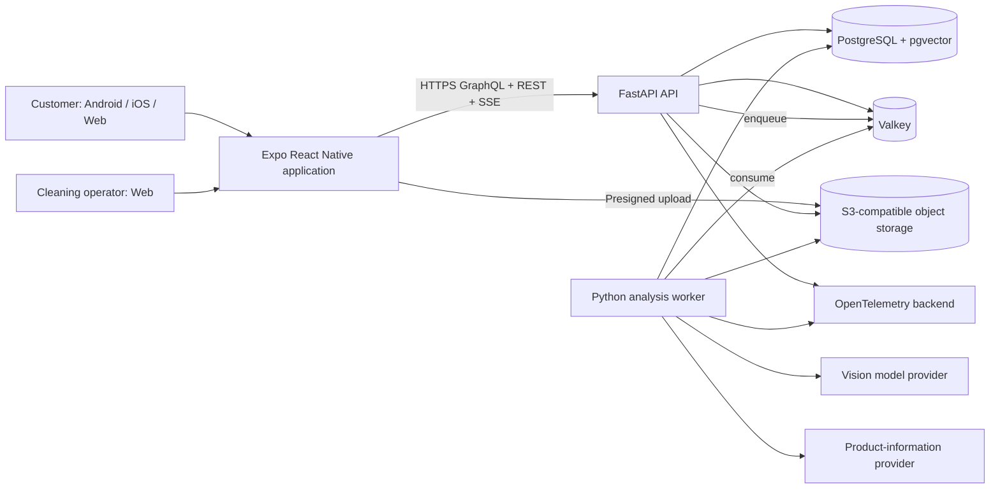
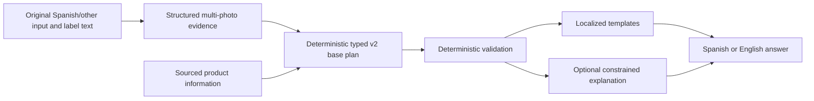
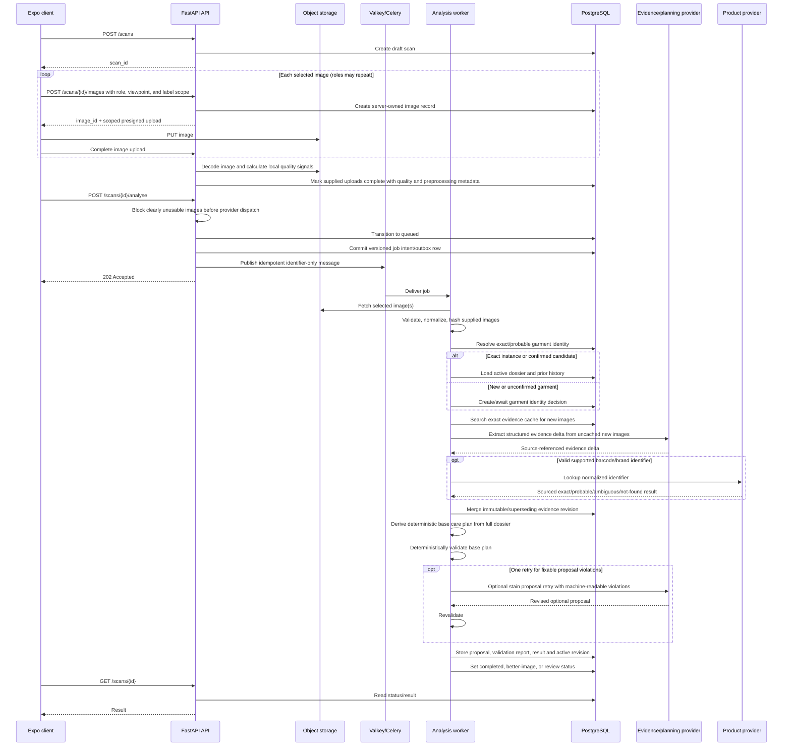
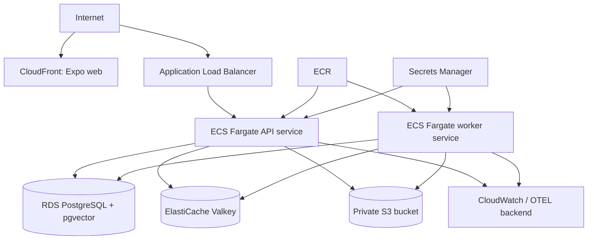

# FabricAssist — Architecture

**Document status:** Initial implementation architecture  
**Related documents:** `docs/requirements.md`, `AGENTS.md`
**Last updated:** 2026-08-03

## 0. Product identity and canonical names

Use these names consistently across source code, infrastructure, documentation, and user-facing interfaces:

- **Product and brand:** `FabricAssist`
- **Repository:** `fabricassist-platform`
- **Python package namespace:** `fabricassist`
- **Expo display name:** `FabricAssist`
- **Expo slug:** `fabricassist`
- **API service/container:** `fabricassist-api`
- **Worker service/container:** `fabricassist-worker`
- **Frontend application/package:** `fabricassist-app`
- **Docker Compose project:** `fabricassist`
- **Project-specific environment-variable prefix:** `FABRICASSIST_`

Write **FabricAssist** in user-facing text. Use lowercase `fabricassist` for package names, service identifiers, container images, URLs, and machine-readable configuration.

## 1. Architecture principles

1. **Deterministic safety gate:** AI extracts evidence and may produce optional typed proposals, but the v2 base care plan is derived by versioned Python policy and every safety-relevant plan or chat claim must pass deterministic validation before release.
2. **Structured before conversational:** Evidence, proposals, actionable chat claims, and product lookups must pass typed schemas before they affect the product.
3. **Cache by evidence, not vague similarity:** Exact images and canonical care facts are safer than generic semantic memory.
4. **PostgreSQL is authoritative:** Valkey is transient infrastructure, not the source of completed results.
5. **Portable infrastructure:** Use standard protocols and adapters so local Docker, AWS, and other container hosts remain viable.
6. **One deployable backend first:** Start with a modular monolith plus a separate worker process, not a distributed microservice system.
7. **Universal customer client:** Use one Expo/React Native codebase for Android, iOS, and the authenticated web application.
8. **Version everything that changes meaning:** Prompts, schemas, models, rules, templates, hashes, and cache keys.
9. **Fail safely:** Missing or contradictory evidence produces uncertainty or human review, never confident invented advice.
10. **Remember the garment, not only the image:** PostgreSQL stores physical garment identity, product identity, evidence revisions, conversations, and performed-service history separately from caches.
11. **Source every enrichment:** Photographed label facts, product-catalog facts, user statements, visual hypotheses, and human corrections retain distinct provenance and authority.
12. **One clean cutover:** The redesign replaces the old two-photo, narrow
    extraction/result, and deterministic-plan-generator path. No compatibility
    shim, deprecated role alias, dual write, or legacy result fallback remains.

## 2. Selected stack

### 2.1 Backend

- Python 3.12 or newer, pinned to a tested minor version in the repository.
- FastAPI for REST APIs and OpenAPI generation.
- Pydantic for request, response, configuration, and model-extraction schemas.
- SQLAlchemy 2.x for persistence.
- Alembic for migrations.
- PostgreSQL as the primary database.
- pgvector as a PostgreSQL extension for optional semantic candidate retrieval.
- Valkey adapters for hot cache, distributed concurrency, and rate limiting.
- Celery as the initial worker framework, with an independently configured
  Redis-compatible or AMQP broker URL.
- `boto3`-compatible object-storage adapter for S3 and local S3-compatible storage.
- Pillow and OpenCV-compatible tooling for image normalization and quality checks.
- `httpx` for model-provider HTTP clients.
- `uv` for Python dependency and virtual-environment management.

Celery must be isolated behind an application job-dispatch interface. If Valkey broker behaviour becomes operationally unsuitable, the broker can move to RabbitMQ without changing domain services.

### 2.1.1 Capability adapter composition

Infrastructure replacement happens by capability, never through one generic
infrastructure or Redis provider:

| Capability port | Registered adapters | Selection setting |
|---|---|---|
| `JobDispatcher` | Celery, QStash | `FABRICASSIST_JOB_DISPATCHER` |
| `HotCache` | Valkey, no-op | `FABRICASSIST_HOT_CACHE_BACKEND` |
| `RateLimiter` | Valkey, no-op | `FABRICASSIST_RATE_LIMITER_BACKEND` |
| `ConcurrencyGate` | Valkey, no-op | `FABRICASSIST_CONCURRENCY_GATE_BACKEND` |
| `VisionEvidenceProvider` | mock, Gemini, OpenAI Responses | `FABRICASSIST_EVIDENCE_PROVIDER` |
| `OptionalStainProposalProvider` | mock, Gemini, OpenAI Responses | module-owned garment-analysis provider setting |
| `ConversationProvider` | mock, Gemini, OpenAI Responses | `FABRICASSIST_CHAT_PROVIDER` |
| `ObjectStorage` | S3-compatible | `FABRICASSIST_OBJECT_STORAGE_BACKEND` |
| `ProductInformationProvider` | mock, allow-listed HTTP JSON | `FABRICASSIST_PRODUCT_INFORMATION_PROVIDER` |

Infrastructure factories translate global typed settings into adapter-specific
configuration and inject ports at composition roots. No-op adapters are
explicit; production rejects no-op request limiting and concurrency.

### 2.2 Frontend

- Expo with React Native and TypeScript.
- Expo Router.
- React Native Web.
- TanStack Query.
- React Hook Form and Zod.
- Zustand only for minimal local state.
- Typed translations with Spanish and English catalogs.
- Generated TypeScript API client from FastAPI OpenAPI.
- `pnpm` for JavaScript package management.

Use an Expo development build for normal development and testing. EAS services are optional rather than required; native projects can be generated and built through normal Android and iOS tooling.

### 2.3 Infrastructure

Local:

- Docker Compose.
- PostgreSQL with pgvector.
- Valkey.
- MinIO or another S3-compatible open-source object store.
- API container.
- Worker container.
- Optional Mailpit for email testing.
- Optional OpenTelemetry Collector and Grafana stack under a Compose profile.

AWS production recommendation:

- Amazon ECR for container images.
- ECS Fargate services for API and workers.
- Application Load Balancer for the API.
- RDS for PostgreSQL with pgvector enabled.
- ElastiCache for Valkey.
- S3 for private image storage.
- CloudFront or another CDN for the Expo web build.
- Secrets Manager or Parameter Store for secrets.
- CloudWatch and/or an OpenTelemetry backend for logs, metrics, and traces.

The production code must also run on a generic container platform with managed PostgreSQL, Valkey, and S3-compatible storage.

## 3. Context diagram



## 4. Runtime architecture

The backend is a modular monolith deployed as two process types from the same codebase:

1. **API process**
   - Authentication and authorization.
   - Scan and upload lifecycle.
   - Presigned URLs.
   - History, results, reviews, and feedback.
   - OpenAPI and health endpoints.
   - Job dispatch.

2. **Worker process**
   - Image validation and normalization.
   - Fingerprint generation.
   - Cache resolution.
   - Multi-photo evidence extraction and provenance.
   - Barcode decoding and trusted product lookup.
   - Garment identity resolution and incremental evidence merging.
   - AI care planning and deterministic plan validation.
   - Contextual conversation jobs and validation.
   - Translation rendering.
   - Review-case creation.
   - Retention and deletion tasks.

This separation permits independent horizontal scaling without introducing network APIs between domain modules.

## 5. Backend module boundaries

```text
backend/
├── src/
│   └── fabricassist/
│       ├── api/
│       │   ├── dependencies/
│       │   ├── routes/
│       │   │   ├── auth.py
│       │   │   ├── scans.py
│       │   │   ├── results.py
│       │   │   ├── reviews.py
│       │   │   └── health.py
│       │   ├── errors.py
│       │   └── main.py
│       ├── services/
│       │   ├── commands/
│       │   ├── queries/
│       │   ├── dto/
│       │   └── ports/
│       ├── domain/
│       │   ├── auth/
│       │   ├── scans/
│       │   ├── extraction/
│       │   ├── care/
│       │   │   ├── evidence/
│       │   │   ├── proposal/
│       │   │   └── validation/
│       │   ├── detergents/
│       │   ├── garments/
│       │   ├── products/
│       │   ├── conversations/
│       │   ├── review/
│       │   └── shared/
│       ├── repositories/
│       ├── infrastructure/
│       │   ├── database/
│       │   ├── object_storage/
│       │   ├── valkey/
│       │   ├── jobs/
│       │   ├── vision_providers/
│       │   ├── product_information/
│       │   ├── telemetry/
│       │   └── security/
│       ├── worker/
│       │   ├── analyse_scan.py
│       │   ├── answer_message.py
│       │   ├── delete_scan_assets.py
│       │   └── retention.py
│       ├── settings.py
│       └── __init__.py
├── migrations/
├── tests/
│   ├── unit/
│   ├── integration/
│   ├── contract/
│   └── fixtures/
├── pyproject.toml
└── Dockerfile
```

### Boundary rule

Domain modules must not import FastAPI, SQLAlchemy sessions, Celery, Valkey clients, `boto3`, or a specific model SDK. Application ports define the required behaviour; infrastructure adapters implement it.

## 6. Frontend structure

```text
frontend/
├── apps/
│   └── client/
│       ├── src/
│       │   ├── app/
│       │   │   ├── _layout.tsx
│       │   │   ├── (auth)/
│       │   │   ├── (customer)/
│       │   │   │   ├── scans/
│       │   │   │   ├── history/
│       │   │   │   └── profile/
│       │   │   └── (operator)/
│       │   │       └── reviews/
│       │   ├── features/
│       │   │   ├── auth/
│       │   │   ├── capture/
│       │   │   ├── scans/
│       │   │   ├── results/
│       │   │   └── reviews/
│       │   ├── components/
│       │   ├── platform/
│       │   ├── i18n/
│       │   └── config/
│       └── app.config.ts
├── packages/
│   ├── api-client/
│   ├── api-types/
│   ├── design-tokens/
│   ├── translations/
│   └── test-utils/
├── package.json
├── pnpm-workspace.yaml
└── turbo.json
```

Platform-specific components should be small adapters:

```text
ImageCapture.native.tsx
ImageCapture.web.tsx
SecureSession.native.ts
SecureSession.web.ts
UploadSource.native.ts
UploadSource.web.ts
```

Business-facing components, validation, API hooks, result rendering, and translations remain shared.

## 7. Monorepo layout

```text
fabricassist-platform/
├── AGENTS.md
├── README.md
├── backend/
├── frontend/
├── infrastructure/
│   ├── compose/
│   ├── terraform/
│   └── scripts/
├── docs/
│   ├── requirements.md
│   ├── architecture.md
│   ├── IMPLEMENTATION_PLAN.md
│   ├── adr/
│   ├── api/
│   ├── prompts/
│   └── runbooks/
├── .github/workflows/
├── Makefile
├── docker-compose.yml
└── .env.example
```

The repository root must provide predictable commands such as:

```bash
make bootstrap
make up
make down
make migrate
make seed
make test
make lint
make openapi
make logs
```

## 8. Data architecture

### 8.1 Why PostgreSQL

PostgreSQL holds relational business data, flexible JSONB model payloads, and optional vectors in one transactional system. A separate document database is not needed for the MVP.

Use normal columns for stable, indexed, safety-relevant values. Preserve provider payloads and evolving extraction details in JSONB for audit and forward compatibility.

### 8.2 Core tables

#### `tenants`

- `id UUID PK`
- `name`
- `default_language`
- `image_retention_days`
- `created_at`

#### `users`

- `id UUID PK`
- `tenant_id UUID FK`
- `email CITEXT`
- `password_hash`
- `role`
- `preferred_language`
- `is_active`
- timestamps

Unique index: `(tenant_id, email)`.

#### `refresh_sessions`

- `id UUID PK`
- `user_id UUID FK`
- `token_hash`
- `family_id UUID`
- `expires_at`
- `revoked_at`
- device metadata

Store only a cryptographic hash of the refresh token.

#### `scans`

- `id UUID PK`
- `tenant_id UUID FK`
- `user_id UUID FK`
- `status`
- `requested_language`
- `progress_stage`
- `progress_percent`
- `active_result_id UUID nullable`
- `garment_id UUID nullable`
- `active_analysis_revision_id UUID nullable`
- `error_code nullable`
- timestamps
- optimistic-lock version

#### `scan_images`

- `id UUID PK`
- `scan_id UUID FK`
- user-declared `kind`: `garment_overview`, `care_label`, `composition_label`,
  `barcode_brand_label`, `stain_closeup`, `damage_closeup`,
  `construction_detail`, or `other`
- model-detected kind and confidence nullable
- display order and optional user caption
- `object_key_original`
- `object_key_normalized`
- `mime_type`
- width, height, bytes
- quality signals JSONB
- retention/deletion timestamps

Multiple images may share a role. The configured MVP default limit is eight
completed images per scan; the database does not encode a two-image assumption.

#### `garments`

- `id UUID PK`
- `tenant_id UUID FK`
- owner/user ID nullable according to tenant workflow
- product profile ID nullable
- display name/category/color/size summaries
- active analysis revision and active result IDs
- created/updated/deleted timestamps

This row represents one physical garment, not a retail product line.

#### `garment_identifiers`

- garment and tenant IDs
- identifier type: FabricAssist QR/serial, confirmed external serial, barcode
  candidate, brand/model composite, or other
- normalized value or scoped cryptographic fingerprint where appropriate
- verification status, source, confidence, and confirmation actor/time

Only a verified instance identifier can produce an automatic
`exact_instance` link. Product and visual identifiers remain candidates.

#### `product_profiles` and `product_identifiers`

- normalized GTIN/barcode, brand, product name, model/style, category, variant,
  color, size, sourced material/care data, and source provenance
- catalog/provider, match status, retrieved/refreshed/invalidated timestamps
- no physical-garment condition, conversation, or service history

#### `product_lookup_runs`

- identifier, provider, operation, request fingerprint, match status
- source/reference and licensing metadata
- schema version, safe raw/validated JSONB snapshots
- latency, status/error category, retrieved/refreshed timestamps

QR-derived URLs are untrusted and pass explicit outbound URL/SSRF policy before
any network request.

#### `analysis_revisions`

- garment/scan/tenant IDs
- revision number and parent/superseded revision nullable
- triggering image IDs and evidence-delta metadata
- status, active flag/pointer, created/finalized timestamps
- pinned module/workflow, merged-schema, care/confidence/retry-policy versions,
  and materially effective feature flags

Prior revisions are never overwritten. A delivery always resumes the workflow
version pinned on its revision rather than adopting changed deployment settings.
Incremental extraction may process only new images, while activation requires validation of the fully merged dossier and
plan.

#### `garment_observations`

- analysis revision and evidence source IDs
- type, normalized value, confidence, provenance, observation time
- stable identity/care or time-varying condition classification
- supersedes observation ID nullable

Stains, damage, wear, and cleanliness are time-varying observations rather than
permanent product attributes.

#### `garment_service_events`

- garment/tenant IDs, actor, event state (`planned`, `performed`, `completed`)
- treatment/cleaning method, outcome, notes, event timestamps, audit references

`analysed_before` comes from analysis history. `cleaned_before` is true only when
a performed/completed service event exists.

#### `image_fingerprints`

- `image_id UUID FK`
- `sha256`
- `phash`
- `normalization_version`

Index exact SHA-256. Perceptual hash lookup may initially use a narrowed candidate set and Hamming distance in application code; optimize only after measuring volume.

#### `analysis_branch_results`

- tenant and analysis-revision IDs, stable branch name, and unique
  `(analysis_revision_id, branch_name)` constraint
- normalized state (`pending`, `running`, `completed`, failure/input states),
  attempt count capped at two, opaque claim token, and lease timestamps
- provider/model/prompt/schema/preprocessing versions, request fingerprint,
  confidence, uncertainty paths, validated result JSONB, and safe error category
- started/completed timestamps

This is the sole durable execution and business-read authority for a v2 branch.
The claim token prevents a stale worker response from overwriting a branch after
another delivery has reclaimed an expired lease. It stores validated JSON only,
never framework checkpoints or provider SDK objects.

#### `behavior_versions`

- tenant ID, immutable behavior type/version/checksum, active or retired state,
  and creation time

This registry tracks module, workflow, prompt, schema, preprocessing, policy,
and materially effective feature-flag assets that are not rulesets.

#### `model_runs`

- `id UUID PK`, tenant/scan IDs, nullable analysis-revision and branch-result IDs
- provider/model/operation, prompt/schema/response-model versions, and request fingerprint
- retry number, image count, routed role counts, latency, input/output/total,
  cached/thought/tool token counts, estimated cost, status/error, and completion time

`model_runs` is immutable provider-usage audit data. It is linked to, but never
supersedes, `analysis_branch_results` as branch-state authority. Do not store
secret headers, raw provider objects, or raw presigned URLs.

#### `label_extractions`

- `id UUID PK`
- `scan_id UUID FK`
- `analysis_revision_id UUID FK`
- `model_run_id UUID FK`
- `raw_payload JSONB`
- `validated_payload JSONB`
- `overall_confidence`
- `is_human_corrected`
- `supersedes_extraction_id nullable`
- timestamps

The broader implementation stores a versioned `garment_evidence_dossier` per
analysis revision. Label extraction remains an evidence component rather than
the complete plan.

#### `extracted_materials`

- `extraction_id UUID FK`
- normalized material code
- displayed/original material text
- percentage nullable
- confidence

#### `extracted_care_facts`

One row per care category:

- `extraction_id UUID FK`
- `category`
- `permission`: `allowed`, `prohibited`, `unknown`
- temperature/heat/process/severity typed fields
- confidence
- source: symbol, written text, both, human
- original evidence JSONB

#### `care_results`

- `id UUID PK`
- `tenant_id UUID FK`
- `analysis_revision_id UUID FK`
- evidence dossier ID, proposed plan ID, and validation report ID
- `canonical_signature`
- `canonical_signature_hash`
- `validator_version`
- `detergent_validator_version`
- normalized result JSONB
- selected searchable typed fields
- `validation_status`: model-only, system-validated, human-approved
- timestamps

Unique validated-cache index should include tenant policy boundary where appropriate, signature hash, and rules versions.

#### `proposed_care_plans`

- analysis revision and model run IDs
- proposal schema/prompt/model versions
- strict plan JSONB plus selected typed safety fields
- evidence references, retry number, status, timestamps

#### `care_validation_reports`

- proposed plan ID
- validator and detergent-validator versions/checksums
- outcome: passed, passed-with-warnings, blocked, better-image, or review
- structured violations/warnings and validated claim set
- created timestamp

The validator does not silently replace a proposal. A constrained retry creates
a new proposal/report pair.

#### `rendered_answers`

- `care_result_id UUID FK`
- `language`
- `template_version`
- structured sections JSONB
- optional prose
- timestamps

Unique key: `(care_result_id, language, template_version)`.

#### `review_cases`

- `id UUID PK`
- `scan_id UUID FK`
- `reason_codes TEXT[]`
- `status`
- assigned operator nullable
- operator note nullable
- resolution timestamps

#### `feedback`

- `id UUID PK`
- `scan_id UUID FK`
- user ID
- type
- comment nullable
- timestamps

#### `conversation_threads`, `conversation_messages`, and `conversation_summaries`

- tenant/user, physical garment, and active analysis revision IDs
- cursor-paginated messages with role, text, structured claims, evidence
  references, model run, validation report, status, and timestamps
- versioned rolling summaries with source-message range and prompt/schema version

Provider-side conversation identifiers are optional adapter metadata and never
the sole durable context.

#### `ruleset_versions`

- type: care, detergent, rendering
- version
- checksum
- activation timestamp
- status
- metadata JSONB

#### `audit_events`

- tenant, actor, action, entity type/id
- safe before/after summary JSONB
- correlation ID
- timestamp

### 8.3 Vector data

Add embedding storage only after the exact and canonical caches are working:

- `care_result_embeddings`
- `care_result_id`
- `embedding_model`
- `embedding_version`
- `embedding vector(n)`
- normalized text checksum

Vector similarity returns candidates. The application must then compare normalized safety fields exactly before reuse.

## 9. Care-domain model

Use explicit enums and value objects for three separate artifacts.

### 9.1 Evidence dossier

`GarmentEvidenceDossier` contains per-image observations, garment category and
construction, photographed care/composition facts, materials, barcodes/brand
labels, product lookup facts, visible stain/damage observations, original text,
confidence, uncertainty, and source image/lookup/user/human references.

### 9.2 Deterministic v2 base plan and optional proposals

The v2 base care plan is a strict typed result derived in deterministic Python
from the complete merged evidence dossier, authority rules, and relevant
cleaning history. It is not generated by a mandatory planning LLM call.
`ProposedCarePlan` remains a strict audit/validation model for optional
model-backed proposals (for example, a policy-gated stain proposal), not the
authority for the base recommendation. A typed plan resembles:

```json
{
  "classification": "definitive",
  "preparation": ["CLOSE_FASTENERS"],
  "stain_treatment": [
    {
      "action": "BLOT_AND_TEST_HIDDEN_AREA",
      "evidence_ids": ["observation-uuid"],
      "confidence": 72
    }
  ],
  "cleaning": {
    "method": "water_wash",
    "maximum_temperature_c": 30,
    "process": "mild"
  },
  "detergent": {
    "category": "delicates_liquid",
    "avoid": ["chlorine_bleach"]
  },
  "drying": ["LINE_DRY"],
  "ironing": {"maximum_temperature_c": 110, "steam": "prohibited"},
  "professional_care": [],
  "prohibited_actions": ["DO_NOT_TUMBLE_DRY", "DO_NOT_BLEACH"],
  "evidence_ids": ["care-fact-uuid", "material-fact-uuid"],
  "uncertainties": ["stain_identity_unconfirmed"],
  "follow_up_questions": ["Do you know what caused the stain?"]
}
```

### 9.3 Validation report and validated result

`CareValidationReport` records `passed`, `passed_with_warnings`, `blocked`,
`needs_better_image`, or `needs_review`, validator versions/checksums, violations,
warnings, and the validated claim IDs. The validator never mutates the proposal
into a different plan. A passed proposal plus its report becomes the active
`ValidatedCareResult`; optional prose and localized sections remain derived
representations.

## 10. AI and external-information architecture

### 10.1 Provider ports

```python
class VisionEvidenceProvider(Protocol):
    async def extract_evidence(
        self,
        *,
        images: tuple[TypedNormalizedImageReference, ...],
        prior_dossier: GarmentEvidenceDossier | None,
    ) -> GarmentEvidenceDelta:
        ...

class OptionalStainProposalProvider(Protocol):
    async def propose_plan(
        self,
        *,
        dossier: GarmentEvidenceDossier,
        validation_feedback: tuple[ValidationViolation, ...] = (),
    ) -> ProposedCarePlan:
        ...

class ProductInformationProvider(Protocol):
    async def lookup(self, identifier: ProductIdentifier) -> ProductLookupResult:
        ...

class ConversationProvider(Protocol):
    async def answer(self, context: ConversationContext) -> AssistantMessageProposal:
        ...
```

Evidence extraction, optional proposal generation, and conversation are
independently selected and injected application ports. One concrete adapter may
implement multiple ports, but each capability factory selects only its own
strategy. Application
services receive non-secret `ProviderDescriptor` values for cache identity and
never receive provider API keys, SDK clients, HTTP headers, endpoints, or the
global settings object. Invocation results remain authoritative for recorded
provider/model/latency/token metadata.

Adapters may include:

- A hosted multimodal provider.
- An OpenAI-compatible endpoint.
- A future local model served through vLLM, Ollama, or another compatible gateway.

Each normalized image reference carries an image ID and declared/detected role.
Multiple images may share a role. Provider adapters own provider-specific
multi-image/tool formatting and return the same strict application boundary
schemas or categorized failures. Domain modules do not import provider DTOs or
infrastructure clients.

Barcode decoding is deterministic where possible. Vision/OCR may locate a code
or recover printed digits; a product lookup is authoritative only as sourced
external evidence. A product match never proves one physical garment instance.

### 10.2 Prompt strategy

- Maintain separate versioned evidence, optional-proposal, repair, conversation, and
  summary prompts in English for engineering consistency.
- Send images and original user/label text without translating them first.
- Instruct the model to preserve visible text verbatim and normalize meaning separately.
- Require `unknown` when evidence is absent.
- Require strict structured output.
- Include prompt and schema versions in every model run.
- Never ask the model to decide whether cached data should be trusted.
- Delimit label, catalog, user, and conversation content as untrusted evidence,
  never as system or tool instructions.
- Require source image/fact IDs for evidence and proposed actions.
- A single constrained planning retry may receive validator violation codes; it
  receives no ability to change validator policy.
- Provide reviewed default system prompts for each operation. An adapter may
  select a model-tailored prompt profile without changing the application port,
  schemas, or validator. Prompt text contains task instructions rather than
  provider names or implementation annotations.

### 10.3 Model result validation

Validation layers:

1. JSON/schema validation.
2. Enum and numeric-range validation.
3. Cross-field validation.
4. Contradiction detection between symbols and written text.
5. Source/provenance and confidence policy.
6. Product/variant and garment-identity conflict detection.
7. Deterministic care-plan and detergent-plan validation.
8. Optional constrained proposal retry.
9. Better-image or human review.

Examples of invalid combinations:

- Washing prohibited and a domestic washing temperature present as definitive advice.
- Dry cleaning prohibited and professional dry cleaning recommended.
- Tumble drying prohibited and a tumble heat level selected.
- Percentages clearly exceeding an accepted tolerance without an uncertainty marker.
- Catalog care that conflicts with the photographed label.
- A proposed stain identity stated as certain from appearance alone.
- A chat claim that introduces an action absent from or contradictory to the
  active validated plan.

## 11. Language architecture



Common output must use templates, for example:

```text
WASH_MAX_TEMP_MILD(30)
DO_NOT_BLEACH
DO_NOT_TUMBLE_DRY
DRY_CLEAN_P_MILD
```

The translation catalog renders validated stable codes into Spanish or English.
An optional explanation model may combine only approved facts and claims into
friendlier prose; structured validated sections remain present and authoritative.

## 12. Cache architecture

### 12.1 Exact image cache

Key material:

```text
normalization_version + normalized_image_sha256 + extraction_schema_version
```

An exact hit can reuse a prior extraction when:

- The extraction is validated.
- The tenant reuse policy permits it.
- The model/schema compatibility policy permits it.
- The prior result has not been invalidated.

Store durable mappings in PostgreSQL. Mirror hot mappings in Valkey.

### 12.2 Perceptual match

A pHash match identifies candidates, not truth. Candidate reuse requires additional equality or revalidation checks. Similar labels can visually differ by only one critical crossed-out symbol.

### 12.3 Canonical care signature

The signature must be generated from a stable serialization containing:

- All normalized care categories.
- Temperatures, heat levels, process letters, and severities.
- Sorted normalized composition.
- Safety-relevant written warning codes.
- Extraction schema version.
- Evidence/proposal schema versions.
- Validator and detergent-validator versions.

Example source string:

```text
wash=allowed:30:mild|
bleach=prohibited|
tumble=prohibited|
iron=allowed:110:steam_prohibited|
dry_clean=allowed:P:mild|
wet_clean=unknown|
materials=cotton:80,polyester:20|
warnings=do_not_iron_decoration|
evidence_schema=2|proposal_schema=2|validator=1|detergent_validator=1
```

Hash the canonical UTF-8 representation with SHA-256.

### 12.4 Semantic candidate cache

pgvector search is optional and must be introduced only after enough human-approved data exists. It cannot bypass an exact field comparison of prohibitions and numeric values.

### 12.5 Garment identity retrieval

Garment identity is durable business data rather than a cache hit. Candidate
resolution uses this order:

1. verified FabricAssist instance QR/serial;
2. previously confirmed instance relationship;
3. tenant/user-scoped exact image and label fingerprints;
4. normalized barcode plus brand/model/size/color/composition composite;
5. pHash or optional vector visual candidates.

Only the first two produce automatic `exact_instance` linking. Later stages
return confirmation candidates and never expose another user's physical history.

### 12.6 Product-information cache

Durable PostgreSQL lookup records include normalized identifier, provider,
source, match status, schema version, retrieved/refreshed/invalidated times, and
validated fields. Valkey may mirror hot exact identifiers. Expiration refreshes
external data without rewriting historical analysis revisions.

### 12.7 Render cache

Valkey key pattern:

```text
fabricassist:answer:v1:{result_id}:{language}:{template_version}
```

The durable rendered answer remains in PostgreSQL. Valkey TTL is an optimization.

## 13. Scan processing sequence



## 14. Job design and idempotency

Each adapter receives the same strict `AnalysisJobMessage` containing only the
schema version, scan/revision identifiers, operation key, and stage. The API
commits an `analysis_job_operations` intent/outbox row before calling Celery or
QStash. Publication acknowledgement is persisted only after transport success.
An identical client retry or reconciler republishes committed-but-unpublished
work with stable transport deduplication; database checkpoint claims make
duplicate delivery safe.

Each execution verifies database state and acquires the configured
`ConcurrencyGate`. Correlation ID is durable outbox metadata and propagates
through either transport.

A bounded API-lifespan recovery loop is active in both Celery and hosted-QStash
topologies. It claims unpublished analysis operations and queued unpublished
conversation rows with PostgreSQL `FOR UPDATE SKIP LOCKED`, preserves their
persisted correlation IDs, and republishes through the same `JobDispatcher`.
The same loop claims durable object-deletion rows, translates storage failures,
and bounds transient retries. PostgreSQL publication/checkpoint/deletion state
remains authoritative if any process stops between commit and external I/O.

Suggested stages:

1. `validate_uploaded_images`
2. `normalize_images`
3. `calculate_fingerprints`
4. `resolve_garment_identity`
5. `resolve_exact_evidence_cache`
6. `extract_new_evidence`
7. `decode_and_lookup_products`
8. `merge_evidence_revision`
9. `derive_deterministic_care_plan`
10. `validate_care_plan`
11. `validate_optional_stain_proposal_once`
12. `resolve_validated_result_cache`
13. `render_answers`
14. `finalize_revision_and_scan`

The first implementation may use one orchestration task with persisted checkpoints. Split stages into separate tasks only when retries, resource classes, or observability justify the added complexity.

Retry policy:

- Network/model transient errors: exponential backoff with jitter and bounded attempts.
- Schema failure: one constrained repair/retry at most, then review/failure.
- Product not-found/ambiguous: persist the safe outcome and continue without
  blind retries; retry only categorized transient provider failures.
- Optional proposal violation: one constrained retry only when the proposal is
  explicitly marked repairable; otherwise block/review immediately. The
  deterministic base plan has no LLM retry path.
- Authorization, invalid image, and deterministic validation failures: no blind retry.
- Job exhaustion: persist `failed`, diagnostic category, and operator-visible retry action.

## 15. API architecture

### 15.1 Error envelope

```json
{
  "error": {
    "code": "SCAN_IMAGE_UNUSABLE",
    "message": "The care label is too blurred to analyse.",
    "details": {
      "guidance": ["Move closer", "Use indirect light"]
    },
    "correlation_id": "..."
  }
}
```

User-facing messages are localized. Stable codes and structured details drive frontend behaviour.

### 15.2 Idempotency

Support an `Idempotency-Key` header for:

- Scan creation.
- Analysis start.
- Feedback submission.
- Review approval.
- Image addition/removal where duplicate submission is plausible.
- Garment candidate confirmation/linking.
- Conversation message submission.
- Service-event creation.

Persist idempotency records for a bounded period in PostgreSQL or use a Valkey fast path backed by database state.

### 15.3 OpenAPI client generation

CI and local commands must:

1. Generate FastAPI OpenAPI JSON.
2. Verify the committed/generated frontend client is current.
3. Generate TypeScript request/response types and API functions.
4. Fail when uncommitted drift exists.

The frontend composition root decorates the generated client once with API base
URL, access-token injection, refresh-once behavior, correlation IDs, and error
envelope conversion. Screens must use generated operations and TanStack Query
where server state benefits from query caching. Presigned object bytes are not
FabricAssist API traffic and remain
behind the platform-specific `BinaryUpload` adapter.

### 15.4 Resource shape

The REST surface adds:

- scan image collection operations so roles may repeat;
- identity-candidate read and explicit garment-link confirmation;
- garment list/detail/history and service events;
- cursor-paginated scan-bound conversation messages; and
- rich typed result sections including evidence provenance, product sources,
  proposal, validation, change summary, and analysed/cleaned history.

Every route enforces tenant and ownership boundaries. Product metadata may be
generic, but another customer's garment relationship, images, condition,
conversation, or service events are never revealed.

## 16. Context construction architecture

PostgreSQL owns conversation truth. `ConversationContextBuilder` creates a
bounded, versioned context from:

1. physical garment and sourced product summaries;
2. active evidence dossier, proposal, and validation report;
3. confirmed service-event history;
4. a versioned rolling conversation summary;
5. the most recent messages within the token budget; and
6. only the raw/normalized images required for the current visual question.

Assistant output contains explanatory text plus structured proposed claims,
evidence references, uncertainty, and follow-up questions. Claims pass the care
validator before the message becomes visible. Message/job state supports queued,
processing, completed, blocked/review, and failed outcomes. Provider-side
conversation IDs are optional adapter metadata.

## 17. Authentication architecture

MVP:

- Email/password.
- Argon2id hashes.
- Short-lived JWT access token.
- Opaque rotating refresh token whose hash is stored in PostgreSQL.
- Refresh-token family revocation on reuse detection.
- Role and tenant claims validated against current account state.

Platform handling:

- Web: refresh token in secure HttpOnly cookie; access token preferably memory-resident.
- Android/iOS: refresh token in Expo SecureStore; access token memory-resident.

Future:

- OIDC adapter for Keycloak or a managed identity provider.
- The domain must identify users by internal UUID, not external provider subject alone.

## 18. Object-storage architecture

Define a port with operations for:

- Create presigned upload.
- Verify object metadata.
- Read a private object.
- Write a normalized derivative.
- Create short-lived download preview.
- Delete an object.

Object key format:

```text
{environment}/{tenant_id}/{scan_id}/{image_id}/{variant}.{extension}
```

Never accept a client-provided key. Bucket access remains private. CORS must allow only approved origins and methods.

## 19. Local Docker architecture

Initial `docker-compose.yml` services use canonical service identifiers:

```text
fabricassist-postgres     PostgreSQL with pgvector
fabricassist-valkey       Valkey
fabricassist-minio        S3-compatible object storage
fabricassist-minio-init   Creates the local bucket and policy in a later infrastructure phase
fabricassist-api          FastAPI development server
fabricassist-worker       Celery worker
fabricassist-mailpit      Optional local email capture
```

Recommended local ports:

```text
API          8000
PostgreSQL   5432
Valkey       6379
MinIO API    9000
MinIO UI     9001
Mailpit UI   8025
```

Use named volumes for PostgreSQL, Valkey when persistence is enabled, and MinIO. Provide a health check for every dependency and make API/worker startup wait for readiness rather than only container start.

Local object-storage configuration must use path-style S3 addressing when required by the emulator.

## 20. Production deployment options

### 20.1 Recommended AWS topology



Deployment characteristics:

- API and worker use separate ECS services and autoscaling policies.
- Database and Valkey live in private subnets.
- API tasks may be private behind the ALB.
- Worker tasks do not require inbound public access.
- Use VPC endpoints where cost and traffic justify them.
- Run Alembic migrations as a one-off deployment task before service rollout.
- Store originals in a private bucket with lifecycle expiration.
- Enable database backups and perform restore drills.

### 20.2 Lower-operations platform option

The same containers may be deployed on a platform such as Render, Fly.io, Railway, or another container host, provided it supports:

- Separate API and worker processes.
- Private networking.
- Managed PostgreSQL with pgvector.
- Managed Valkey or compatible private Valkey.
- S3-compatible private object storage.
- Secrets injection.
- Health checks and rolling deployments.

Do not select a host whose filesystem is the only durable image store.

### 20.3 Self-hosted option

A small production deployment can run through Docker Compose on a virtual machine, but it requires explicit responsibility for:

- TLS and reverse proxy.
- Database backups and point-in-time recovery.
- Valkey persistence/availability.
- Object-storage durability.
- Updates and vulnerability management.
- Monitoring and alerting.

Use this only when operational ownership is accepted.

## 21. Configuration

Configuration must use typed environment settings. Provide `.env.example` without secrets.

Minimum settings groups:

```text
FABRICASSIST_ENVIRONMENT
FABRICASSIST_APP_BASE_URL
FABRICASSIST_API_PUBLIC_URL
FABRICASSIST_CORS_ALLOWED_ORIGINS

FABRICASSIST_DATABASE_URL
FABRICASSIST_VALKEY_URL
FABRICASSIST_CELERY_BROKER_URL
FABRICASSIST_CELERY_RESULT_BACKEND
FABRICASSIST_JOB_DISPATCHER
FABRICASSIST_HOT_CACHE_BACKEND
FABRICASSIST_RATE_LIMITER_BACKEND
FABRICASSIST_CONCURRENCY_GATE_BACKEND

FABRICASSIST_S3_ENDPOINT_URL
FABRICASSIST_S3_REGION
FABRICASSIST_S3_BUCKET
FABRICASSIST_S3_ACCESS_KEY
FABRICASSIST_S3_SECRET_KEY
FABRICASSIST_S3_FORCE_PATH_STYLE

FABRICASSIST_EVIDENCE_PROVIDER
FABRICASSIST_CHAT_PROVIDER
FABRICASSIST_OBJECT_STORAGE_BACKEND
FABRICASSIST_PRODUCT_INFORMATION_PROVIDER
FABRICASSIST_OPENAI_RESPONSES_BASE_URL
FABRICASSIST_OPENAI_RESPONSES_MODEL
FABRICASSIST_OPENAI_RESPONSES_API_KEY
FABRICASSIST_OPENAI_RESPONSES_EXTRA_HEADERS_JSON
FABRICASSIST_VISION_TIMEOUT_SECONDS
FABRICASSIST_VISION_MAX_CONCURRENCY
FABRICASSIST_GEMINI_API_KEY
FABRICASSIST_GEMINI_MODEL

FABRICASSIST_CONVERSATION_RECENT_MESSAGE_LIMIT
FABRICASSIST_CONVERSATION_RELEVANT_IMAGE_LIMIT

FABRICASSIST_PRODUCT_HTTP_JSON_BASE_URL
FABRICASSIST_PRODUCT_HTTP_JSON_API_KEY
FABRICASSIST_PRODUCT_HTTP_JSON_TIMEOUT_SECONDS
FABRICASSIST_PRODUCT_HTTP_JSON_ALLOWED_HOSTS

FABRICASSIST_ACCESS_TOKEN_SECRET
FABRICASSIST_ACCESS_TOKEN_MINUTES
FABRICASSIST_REFRESH_TOKEN_DAYS

FABRICASSIST_DEFAULT_IMAGE_RETENTION_DAYS
FABRICASSIST_UPLOAD_MAX_BYTES
FABRICASSIST_MAX_IMAGES_PER_SCAN
FABRICASSIST_PUBLICATION_RECOVERY_INTERVAL_SECONDS
FABRICASSIST_PUBLICATION_RECOVERY_BATCH_SIZE
FABRICASSIST_DELETION_MAX_ATTEMPTS

FABRICASSIST_OTEL_EXPORTER_OTLP_ENDPOINT
FABRICASSIST_LOG_LEVEL
```

Production must validate that insecure development defaults are absent at startup.

## 22. Validation policies and templates as versioned assets

Initial validation policies should be stored as reviewed code/data files in the repository, for example:

```text
backend/src/fabricassist/domain/care/validation/data/v1.json
backend/src/fabricassist/domain/detergents/validation/data/v1.json
frontend/packages/translations/src/es.json
frontend/packages/translations/src/en.json
```

At application startup:

1. Validate the file schema.
2. Calculate a checksum.
3. Verify or register the corresponding validator/template version record.
4. Refuse activation when the content differs from an already-active immutable version.

An admin editor is not required for the MVP. Validator changes must pass code
review, textile-care review, and safety regression tests. Prompts, schemas,
context summaries, barcode normalization, product adapters, and identity
matching policies carry independent versions.

## 23. Observability

### 23.1 Logs

Structured fields:

- timestamp
- level
- service/process
- environment
- correlation ID
- tenant ID when safe
- user ID when safe
- scan ID
- job ID
- stage
- duration
- error category

Never log image bytes, passwords, refresh tokens, API keys, or complete presigned URLs.

### 23.2 Metrics

Minimum metrics:

- HTTP request count, latency, and error rate.
- Queue depth and oldest-job age.
- Job duration and retries by stage.
- Model calls, errors, latency, and tokens.
- Product lookup calls, match outcomes, latency, refresh, and errors.
- Garment identity classifications, confirmations, conflicts, and false-match feedback.
- Conversation duration, context size, retries, blocked claims, and review rate.
- Exact/canonical/semantic cache hit rate.
- `needs_better_image` and human-review rate.
- Results approved/corrected by operators.
- Object-storage errors.
- Database pool usage.

### 23.3 Traces

Trace a scan from upload completion through API enqueue, worker stages, model call, database writes, and finalization.

## 24. Testing architecture

### 24.1 Backend

- Unit tests for domain value objects, evidence merging, identity classification,
  proposed plans, validation policies, product normalization, and conversation context.
- Property/table-driven tests for prohibited combinations and validator outcomes.
- Repository integration tests against real PostgreSQL in containers.
- Valkey and job integration tests.
- Object-storage contract tests against MinIO.
- Provider contract tests with recorded/synthetic responses; do not require paid calls in default CI.
- Product-information adapter and SSRF/outbound-policy contract tests with local
  synthetic servers only.
- A small opt-in live-provider test suite.

### 24.2 Frontend

- Unit tests for hooks and formatting.
- Component tests for capture guidance and result rendering.
- Component tests for the multi-photo gallery, identity confirmation, sourced
  product facts, analysed/cleaned history, change summaries, and chat states.
- Web E2E flow with Playwright.
- Native smoke tests on Android emulator; add iOS CI when a macOS runner is available.

### 24.3 AI evaluation set

Maintain versioned fixtures containing:

- Clear labels.
- Blurred labels.
- Glare and folds.
- Multiple languages.
- Written instructions that supplement symbols.
- Contradictions.
- Dry-clean-only cases.
- Do-not-dry-clean cases.
- Wool, silk, technical fabric, leather/suede flags.
- Unknown or cropped symbols.
- Multiple images and repeated roles with per-fact source references.
- Visible stain hypotheses and user-confirmed stain identity.
- Exact/invalid/ambiguous/not-found barcode lookups and catalog-label conflicts.
- Exact garment tags, probable/product/visual candidates, identity conflicts,
  and same-product/different-physical-instance cases.
- Incremental evidence deltas, supersession, and full-plan revalidation.
- Contextual follow-ups that attempt to contradict label prohibitions or inject instructions.

Store expected normalized evidence, proposal constraints, validator outcomes,
identity/lookup classifications, and acceptable confidence/review outcomes, not
only final prose.

## 25. CI/CD

GitHub Actions baseline:

1. Backend lint, format check, type check, and tests.
2. Frontend lint, type check, tests, and web build.
3. OpenAPI generation and drift check.
4. Alembic migration checks.
5. Docker image builds.
6. Vulnerability scan.
7. Optional integration test stack using Docker services.
8. Push images after protected-branch approval.
9. Run migrations as a deployment job.
10. Deploy API and worker with rolling replacement.

Production deploys must support rollback to the previous container image. Database changes must follow expand/migrate/contract patterns when rollback compatibility matters.

## 26. Architecture decisions

Create Architecture Decision Records under `docs/adr/` for at least:

- ADR-001: Modular monolith with separate API and worker processes.
- ADR-002: PostgreSQL/JSONB/pgvector instead of MongoDB and a separate vector database.
- ADR-003: Valkey for transient cache and initial job coordination.
- ADR-004: Expo universal client and conditions for introducing Next.js.
- ADR-005: Original deterministic care-rule authority (superseded by ADR-009).
- ADR-006: Provider-neutral vision adapter.
- ADR-007: Direct-to-object-storage uploads.
- ADR-008: Engram deferred; durable memory implemented with PostgreSQL and cache layers.
- ADR-009: AI-proposed structured care plans with deterministic validation gates;
  refined for the deterministic v2 base plan by ADR-019.
- ADR-019: Garment-analysis module, native asyncio workflow, PostgreSQL branch
  authority, and graph-engine adoption threshold.
- ADR-010: Physical garment identity/history separated from product identity.
- ADR-011: Trusted, sourced product-information lookup behind adapters.
- ADR-012: Server-owned contextual conversation state in PostgreSQL.
- ADR-016: Mixed GraphQL reads, REST commands, and durable SSE run events.
- ADR-017: Unified v1 API with read-only GraphQL, REST-only writes, shared
  application services, and canonical SSE recovery.

## 27. Initial implementation order for Codex

### Commit 1 — Repository foundation

- Create monorepo directories.
- Add root README, Makefile, environment example, editor configuration, and CI skeleton.
- Add Docker Compose with PostgreSQL/pgvector, Valkey, MinIO, API, and worker placeholders.

### Commit 2 — Backend foundation

- Configure FastAPI, typed settings, SQLAlchemy, Alembic, health endpoints, error envelope, logging, and database session handling.
- Add initial tenant/user/scan/image migrations.

### Commit 3 — Frontend foundation

- Create Expo Router app with TypeScript strict mode.
- Add Spanish/English localization, API configuration, authentication route groups, and responsive shell.
- Set up OpenAPI client generation.

### Commit 4 — Authentication vertical slice

- Implement register/login/refresh/logout.
- Implement secure platform token adapters.
- Add authorization tests.

### Commit 5 — Upload vertical slice

- Implement scan creation, storage adapter, presigned upload, upload completion, and image metadata verification.
- Add mobile/web image source adapters.

### Commit 6 — Async analysis skeleton

- Configure Celery/Valkey.
- Add idempotent analysis job and scan status polling.
- Add mocked vision provider and deterministic fixture response.

### Commit 7 — Multi-photo and analysis revisions

- Generalize uploads to one-to-eight images with repeated typed roles.
- Add physical garment, product profile, analysis revision, observation, and
  active revision/result foundations through Alembic.
- Remove the legacy `garment`/fixed-two-photo contract and update the generated
  client and Expo gallery in the same breaking release.

### Commit 8 — Rich evidence dossier

- Move domain evidence types out of application/provider modules.
- Add source-referenced garment, label, composition, barcode, stain, damage, and
  construction evidence plus immutable/superseding delta merge semantics.
- Extend mock and configured vision adapters with strict contract fixtures.

### Commit 9 — Deterministic care policy and validation

- Add the deterministic v2 care-policy engine, strict audit/proposal schemas,
  versioned validation policies, detergent validator, optional constrained
  proposal retry, and persisted reports.
- Remove `decide_care()` and its legacy result/render path when the new policy,
  validator, and rich result become active. Do not retain a fallback execution path.
- Add exhaustive prohibition, conflict, garment-only, sensitive-material, stain,
  and chat-claim safety tests.

### Commit 10 — Rich multilingual results

- Render sourced materials/product facts, visible condition, preparation,
  cleaning, detergent, drying, ironing, professional care, prohibitions,
  uncertainty, validation state, and change summary in Spanish and English.
- Preserve structured validated sections even when optional prose is generated.

### Commit 11 — Garment identity and service history

- Implement exact/probable/same-product/visual/new/conflict resolution and
  confirmation UI.
- Add FabricAssist instance QR/serial identifiers and separate analysed-before
  from confirmed performed-service events.
- Reuse stable evidence while extracting new images and revalidating the full plan.

### Commit 12 — Barcode product enrichment

- Decode/normalize supported identifiers and add a no-network mock plus
  provider-neutral trusted product-information adapter.
- Persist source, match, retrieval, refresh, validation, and conflict provenance.
- Add SSRF/outbound policy and catalog-label authority tests.

### Commit 13 — Contextual conversation

- Persist scan/garment-bound threads, messages, rolling summaries, and revision
  references in PostgreSQL.
- Build bounded context and validate every safety-relevant assistant claim.
- Add localized chat UI, rate limits, retries, retention, and deletion coverage.

### Commit 14 — Caching and incremental efficiency

- Add exact evidence, product lookup, canonical validated result, and rendered
  caches with PostgreSQL authority and Valkey hot mirrors.
- Add pHash/optional vector identity candidates only after exact identifiers and
  confirmation behavior are proven safe.

### Commit 15 — Review and deletion

- Add operator review screens and API.
- Add correction/audit flow.
- Add history, deletion, and retention task.

### Commit 16 — Production readiness

- Add telemetry, dashboards/runbooks, AWS Terraform baseline or selected hosting configuration, backup documentation, and load/security checks.

Each commit must leave tests passing and local startup documented.

Commits 7–10 are one coordinated breaking core release. They may be reviewed
separately, but mixed old/new clients are unsupported and the release is not
complete until the old roles, narrow extraction/result/renderer, and
`decide_care()` execution have been removed.

## 28. Deferred decisions

The following should remain configurable or deferred until measurements exist:

- Hosted model provider and exact model.
- Celery/Valkey versus RabbitMQ broker migration.
- Whether a separate Next.js operator portal is needed.
- Semantic similarity threshold and embedding model.
- Product-information providers, source licensing, refresh periods, and exact
  supported barcode standards beyond the mock/local contract.
- Whether FabricAssist instance identifiers are printed QR, NFC, or another
  tenant workflow; the domain identifier contract is not deferred.
- Automatic probable-match thresholds; initial non-exact matches require confirmation.
- SSE hosting timeout/connection behavior and event-retention duration; persisted REST status remains the recovery fallback.
- Self-hosted multimodal inference.
- Multi-region deployment.
- Paid consumer subscriptions and payments.

Do not solve these prematurely in the MVP.
