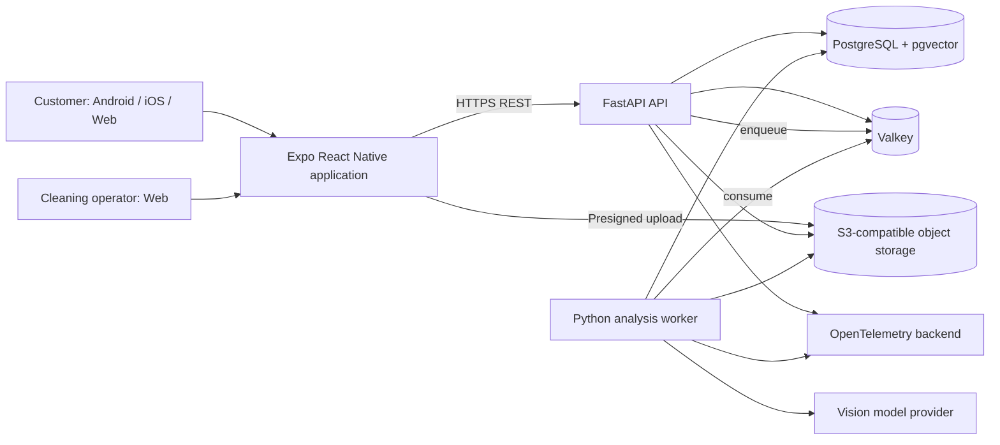
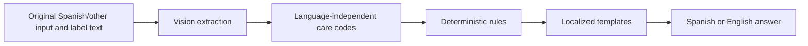
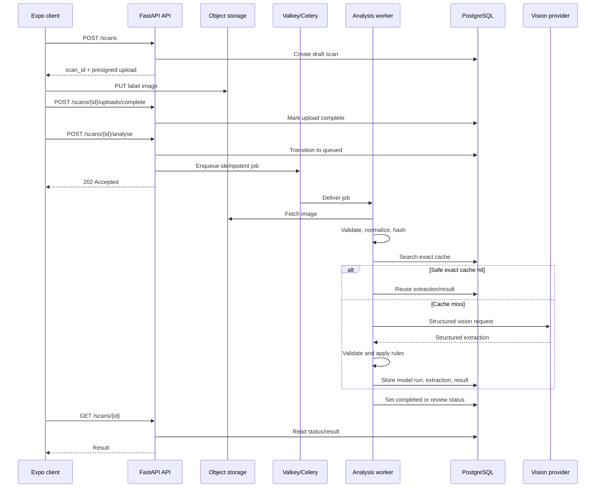
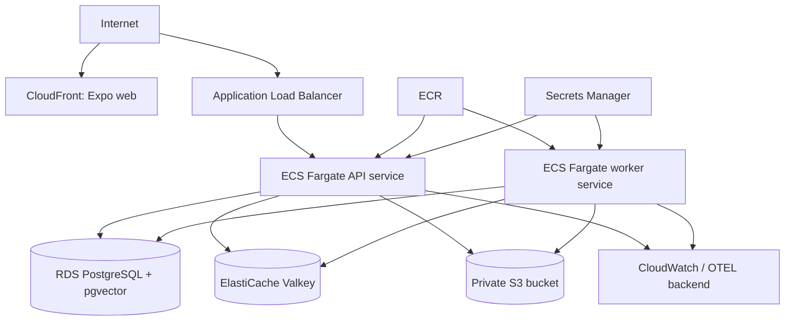

# FabricAssist — Architecture

**Document status:** Initial implementation architecture  
**Related documents:** `docs/requirements.md`, `AGENTS.md`
**Last updated:** 2026-07-20

## 0. Product identity and canonical names

Use these names consistently across source code, infrastructure, documentation, and user-facing interfaces:

- **Product and brand:** `FabricAssist`
- **Repository:** `fabricassist-platform`
- **Python package namespace:** `fabricassist`
- **Expo display name:** `FabricAssist`
- **Expo slug:** `fabricassist`
- **API service/container:** `fabricassist-api`
- **Worker service/container:** `fabricassist-worker`
- **Frontend application/package:** `fabricassist-app`
- **Docker Compose project:** `fabricassist`
- **Project-specific environment-variable prefix:** `FABRICASSIST_`

Write **FabricAssist** in user-facing text. Use lowercase `fabricassist` for package names, service identifiers, container images, URLs, and machine-readable configuration.

## 1. Architecture principles

1. **Deterministic safety:** The LLM extracts facts; Python rules decide and validate care instructions.
2. **Structured before conversational:** All model output must pass a typed schema before it affects the product.
3. **Cache by evidence, not vague similarity:** Exact images and canonical care facts are safer than generic semantic memory.
4. **PostgreSQL is authoritative:** Valkey is transient infrastructure, not the source of completed results.
5. **Portable infrastructure:** Use standard protocols and adapters so local Docker, AWS, and other container hosts remain viable.
6. **One deployable backend first:** Start with a modular monolith plus a separate worker process, not a distributed microservice system.
7. **Universal customer client:** Use one Expo/React Native codebase for Android, iOS, and the authenticated web application.
8. **Version everything that changes meaning:** Prompts, schemas, models, rules, templates, hashes, and cache keys.
9. **Fail safely:** Missing or contradictory evidence produces uncertainty or human review, never confident invented advice.

## 2. Selected stack

### 2.1 Backend

- Python 3.12 or newer, pinned to a tested minor version in the repository.
- FastAPI for REST APIs and OpenAPI generation.
- Pydantic for request, response, configuration, and model-extraction schemas.
- SQLAlchemy 2.x for persistence.
- Alembic for migrations.
- PostgreSQL as the primary database.
- pgvector as a PostgreSQL extension for optional semantic candidate retrieval.
- Valkey for cache, distributed locks, rate limits, and job broker/result coordination.
- Celery as the initial durable worker framework, using Valkey through the Redis-compatible protocol.
- `boto3`-compatible object-storage adapter for S3 and local S3-compatible storage.
- Pillow and OpenCV-compatible tooling for image normalization and quality checks.
- `httpx` for model-provider HTTP clients.
- `uv` for Python dependency and virtual-environment management.

Celery must be isolated behind an application job-dispatch interface. If Valkey broker behaviour becomes operationally unsuitable, the broker can move to RabbitMQ without changing domain services.

### 2.2 Frontend

- Expo with React Native and TypeScript.
- Expo Router.
- React Native Web.
- TanStack Query.
- React Hook Form and Zod.
- Zustand only for minimal local state.
- Typed translations with Spanish and English catalogs.
- Generated TypeScript API client from FastAPI OpenAPI.
- `pnpm` for JavaScript package management.

Use an Expo development build for normal development and testing. EAS services are optional rather than required; native projects can be generated and built through normal Android and iOS tooling.

### 2.3 Infrastructure

Local:

- Docker Compose.
- PostgreSQL with pgvector.
- Valkey.
- MinIO or another S3-compatible open-source object store.
- API container.
- Worker container.
- Optional Mailpit for email testing.
- Optional OpenTelemetry Collector and Grafana stack under a Compose profile.

AWS production recommendation:

- Amazon ECR for container images.
- ECS Fargate services for API and workers.
- Application Load Balancer for the API.
- RDS for PostgreSQL with pgvector enabled.
- ElastiCache for Valkey.
- S3 for private image storage.
- CloudFront or another CDN for the Expo web build.
- Secrets Manager or Parameter Store for secrets.
- CloudWatch and/or an OpenTelemetry backend for logs, metrics, and traces.

The production code must also run on a generic container platform with managed PostgreSQL, Valkey, and S3-compatible storage.

## 3. Context diagram



## 4. Runtime architecture

The backend is a modular monolith deployed as two process types from the same codebase:

1. **API process**
   - Authentication and authorization.
   - Scan and upload lifecycle.
   - Presigned URLs.
   - History, results, reviews, and feedback.
   - OpenAPI and health endpoints.
   - Job dispatch.

2. **Worker process**
   - Image validation and normalization.
   - Fingerprint generation.
   - Cache resolution.
   - Vision-provider calls.
   - Rules evaluation.
   - Translation rendering.
   - Review-case creation.
   - Retention and deletion tasks.

This separation permits independent horizontal scaling without introducing network APIs between domain modules.

## 5. Backend module boundaries

```text
backend/
├── src/
│   └── fabricassist/
│       ├── api/
│       │   ├── dependencies/
│       │   ├── routes/
│       │   │   ├── auth.py
│       │   │   ├── scans.py
│       │   │   ├── results.py
│       │   │   ├── reviews.py
│       │   │   └── health.py
│       │   ├── errors.py
│       │   └── main.py
│       ├── services/
│       │   ├── commands/
│       │   ├── queries/
│       │   ├── dto/
│       │   └── ports/
│       ├── domain/
│       │   ├── auth/
│       │   ├── scans/
│       │   ├── extraction/
│       │   ├── care_rules/
│       │   ├── detergents/
│       │   ├── review/
│       │   └── shared/
│       ├── repositories/
│       ├── infrastructure/
│       │   ├── database/
│       │   ├── object_storage/
│       │   ├── valkey/
│       │   ├── jobs/
│       │   ├── vision_providers/
│       │   ├── telemetry/
│       │   └── security/
│       ├── worker/
│       │   ├── analyse_scan.py
│       │   ├── delete_scan_assets.py
│       │   └── retention.py
│       ├── settings.py
│       └── __init__.py
├── migrations/
├── tests/
│   ├── unit/
│   ├── integration/
│   ├── contract/
│   └── fixtures/
├── pyproject.toml
└── Dockerfile
```

### Boundary rule

Domain modules must not import FastAPI, SQLAlchemy sessions, Celery, Valkey clients, `boto3`, or a specific model SDK. Application ports define the required behaviour; infrastructure adapters implement it.

## 6. Frontend structure

```text
frontend/
├── apps/
│   └── client/
│       ├── src/
│       │   ├── app/
│       │   │   ├── _layout.tsx
│       │   │   ├── (auth)/
│       │   │   ├── (customer)/
│       │   │   │   ├── scans/
│       │   │   │   ├── history/
│       │   │   │   └── profile/
│       │   │   └── (operator)/
│       │   │       └── reviews/
│       │   ├── features/
│       │   │   ├── auth/
│       │   │   ├── capture/
│       │   │   ├── scans/
│       │   │   ├── results/
│       │   │   └── reviews/
│       │   ├── components/
│       │   ├── platform/
│       │   ├── i18n/
│       │   └── config/
│       └── app.config.ts
├── packages/
│   ├── api-client/
│   ├── api-types/
│   ├── design-tokens/
│   ├── translations/
│   └── test-utils/
├── package.json
├── pnpm-workspace.yaml
└── turbo.json
```

Platform-specific components should be small adapters:

```text
ImageCapture.native.tsx
ImageCapture.web.tsx
SecureSession.native.ts
SecureSession.web.ts
UploadSource.native.ts
UploadSource.web.ts
```

Business-facing components, validation, API hooks, result rendering, and translations remain shared.

## 7. Monorepo layout

```text
fabricassist-platform/
├── AGENTS.md
├── README.md
├── backend/
├── frontend/
├── infrastructure/
│   ├── compose/
│   ├── terraform/
│   └── scripts/
├── docs/
│   ├── requirements.md
│   ├── architecture.md
│   ├── IMPLEMENTATION_PLAN.md
│   ├── adr/
│   ├── api/
│   └── runbooks/
├── .github/workflows/
├── Makefile
├── docker-compose.yml
└── .env.example
```

The repository root must provide predictable commands such as:

```bash
make bootstrap
make up
make down
make migrate
make seed
make test
make lint
make openapi
make logs
```

## 8. Data architecture

### 8.1 Why PostgreSQL

PostgreSQL holds relational business data, flexible JSONB model payloads, and optional vectors in one transactional system. A separate document database is not needed for the MVP.

Use normal columns for stable, indexed, safety-relevant values. Preserve provider payloads and evolving extraction details in JSONB for audit and forward compatibility.

### 8.2 Core tables

#### `tenants`

- `id UUID PK`
- `name`
- `default_language`
- `image_retention_days`
- `created_at`

#### `users`

- `id UUID PK`
- `tenant_id UUID FK`
- `email CITEXT`
- `password_hash`
- `role`
- `preferred_language`
- `is_active`
- timestamps

Unique index: `(tenant_id, email)`.

#### `refresh_sessions`

- `id UUID PK`
- `user_id UUID FK`
- `token_hash`
- `family_id UUID`
- `expires_at`
- `revoked_at`
- device metadata

Store only a cryptographic hash of the refresh token.

#### `scans`

- `id UUID PK`
- `tenant_id UUID FK`
- `user_id UUID FK`
- `status`
- `requested_language`
- `progress_stage`
- `progress_percent`
- `active_result_id UUID nullable`
- `error_code nullable`
- timestamps
- optimistic-lock version

#### `scan_images`

- `id UUID PK`
- `scan_id UUID FK`
- `kind`: `garment`, `label`, or `other`
- `object_key_original`
- `object_key_normalized`
- `mime_type`
- width, height, bytes
- quality signals JSONB
- retention/deletion timestamps

#### `image_fingerprints`

- `image_id UUID FK`
- `sha256`
- `phash`
- `normalization_version`

Index exact SHA-256. Perceptual hash lookup may initially use a narrowed candidate set and Hamming distance in application code; optimize only after measuring volume.

#### `model_runs`

- `id UUID PK`
- `scan_id UUID FK`
- `provider`
- `model`
- `operation`
- `prompt_version`
- `schema_version`
- request fingerprint
- latency
- input/output token counts nullable
- estimated cost nullable
- status and error category
- timestamps

Do not store secret headers or raw presigned URLs.

#### `label_extractions`

- `id UUID PK`
- `scan_id UUID FK`
- `model_run_id UUID FK`
- `raw_payload JSONB`
- `validated_payload JSONB`
- `overall_confidence`
- `is_human_corrected`
- `supersedes_extraction_id nullable`
- timestamps

#### `extracted_materials`

- `extraction_id UUID FK`
- normalized material code
- displayed/original material text
- percentage nullable
- confidence

#### `extracted_care_facts`

One row per care category:

- `extraction_id UUID FK`
- `category`
- `permission`: `allowed`, `prohibited`, `unknown`
- temperature/heat/process/severity typed fields
- confidence
- source: symbol, written text, both, human
- original evidence JSONB

#### `care_results`

- `id UUID PK`
- `tenant_id UUID FK`
- `source_extraction_id UUID FK`
- `canonical_signature`
- `canonical_signature_hash`
- `rules_version`
- `detergent_rules_version`
- normalized result JSONB
- selected searchable typed fields
- `validation_status`: model-only, system-validated, human-approved
- timestamps

Unique validated-cache index should include tenant policy boundary where appropriate, signature hash, and rules versions.

#### `rendered_answers`

- `care_result_id UUID FK`
- `language`
- `template_version`
- structured sections JSONB
- optional prose
- timestamps

Unique key: `(care_result_id, language, template_version)`.

#### `review_cases`

- `id UUID PK`
- `scan_id UUID FK`
- `reason_codes TEXT[]`
- `status`
- assigned operator nullable
- operator note nullable
- resolution timestamps

#### `feedback`

- `id UUID PK`
- `scan_id UUID FK`
- user ID
- type
- comment nullable
- timestamps

#### `ruleset_versions`

- type: care, detergent, rendering
- version
- checksum
- activation timestamp
- status
- metadata JSONB

#### `audit_events`

- tenant, actor, action, entity type/id
- safe before/after summary JSONB
- correlation ID
- timestamp

### 8.3 Vector data

Add embedding storage only after the exact and canonical caches are working:

- `care_result_embeddings`
- `care_result_id`
- `embedding_model`
- `embedding_version`
- `embedding vector(n)`
- normalized text checksum

Vector similarity returns candidates. The application must then compare normalized safety fields exactly before reuse.

## 9. Care-domain model

Use explicit enums and value objects. A canonical result resembles:

```json
{
  "washing": {
    "permission": "allowed",
    "maximum_temperature_c": 30,
    "process": "mild"
  },
  "bleaching": {
    "permission": "prohibited",
    "allowed_type": null
  },
  "tumble_drying": {
    "permission": "prohibited",
    "heat": null
  },
  "natural_drying": {
    "method": "line_dry",
    "shade": false
  },
  "ironing": {
    "permission": "allowed",
    "maximum_temperature_c": 110,
    "steam": "prohibited"
  },
  "professional_dry_cleaning": {
    "permission": "allowed",
    "process": "P",
    "severity": "mild",
    "professional_only": true
  },
  "professional_wet_cleaning": {
    "permission": "unknown",
    "severity": null,
    "professional_only": true
  },
  "detergent": {
    "category": "delicates_liquid",
    "avoid": ["chlorine_bleach"]
  },
  "warnings": ["DO_NOT_IRON_DECORATION"],
  "uncertain_fields": []
}
```

The canonical object is data, not final prose.

## 10. LLM and vision-provider architecture

### 10.1 Provider port

```python
class VisionExtractionProvider(Protocol):
    async def extract_label(
        self,
        *,
        image: NormalizedImageReference,
        context: ExtractionContext,
    ) -> LabelExtraction:
        ...
```

Adapters may include:

- A hosted multimodal provider.
- An OpenAI-compatible endpoint.
- A future local model served through vLLM, Ollama, or another compatible gateway.

The provider adapter owns provider-specific request formatting. It must return the same domain schema or a categorized failure.

### 10.2 Prompt strategy

- Maintain the system/developer extraction prompt in English for engineering consistency.
- Send images and original user/label text without translating them first.
- Instruct the model to preserve visible text verbatim and normalize meaning separately.
- Require `unknown` when evidence is absent.
- Require strict structured output.
- Include prompt and schema versions in every model run.
- Never ask the model to decide whether cached data should be trusted.

### 10.3 Model result validation

Validation layers:

1. JSON/schema validation.
2. Enum and numeric-range validation.
3. Cross-field validation.
4. Contradiction detection between symbols and written text.
5. Confidence policy.
6. Deterministic care rules.
7. Optional human review.

Examples of invalid combinations:

- Washing prohibited and a domestic washing temperature present as definitive advice.
- Dry cleaning prohibited and professional dry cleaning recommended.
- Tumble drying prohibited and a tumble heat level selected.
- Percentages clearly exceeding an accepted tolerance without an uncertainty marker.

## 11. Language architecture



Common output must use templates, for example:

```text
WASH_MAX_TEMP_MILD(30)
DO_NOT_BLEACH
DO_NOT_TUMBLE_DRY
DRY_CLEAN_P_MILD
```

The translation catalog renders these into Spanish or English. An optional explanation model may combine already-approved facts into friendlier prose, but its response must be checked against the canonical object and must never be the sole rendered output.

## 12. Cache architecture

### 12.1 Exact image cache

Key material:

```text
normalization_version + normalized_image_sha256 + extraction_schema_version
```

An exact hit can reuse a prior extraction when:

- The extraction is validated.
- The tenant reuse policy permits it.
- The model/schema compatibility policy permits it.
- The prior result has not been invalidated.

Store durable mappings in PostgreSQL. Mirror hot mappings in Valkey.

### 12.2 Perceptual match

A pHash match identifies candidates, not truth. Candidate reuse requires additional equality or revalidation checks. Similar labels can visually differ by only one critical crossed-out symbol.

### 12.3 Canonical care signature

The signature must be generated from a stable serialization containing:

- All normalized care categories.
- Temperatures, heat levels, process letters, and severities.
- Sorted normalized composition.
- Safety-relevant written warning codes.
- Extraction schema version.
- Care-rules version.
- Detergent-rules version.

Example source string:

```text
wash=allowed:30:mild|
bleach=prohibited|
tumble=prohibited|
iron=allowed:110:steam_prohibited|
dry_clean=allowed:P:mild|
wet_clean=unknown|
materials=cotton:80,polyester:20|
warnings=do_not_iron_decoration|
schema=3|care_rules=5|detergent_rules=2
```

Hash the canonical UTF-8 representation with SHA-256.

### 12.4 Semantic candidate cache

pgvector search is optional and must be introduced only after enough human-approved data exists. It cannot bypass an exact field comparison of prohibitions and numeric values.

### 12.5 Render cache

Valkey key pattern:

```text
fabricassist:answer:v1:{result_id}:{language}:{template_version}
```

The durable rendered answer remains in PostgreSQL. Valkey TTL is an optimization.

## 13. Scan processing sequence



## 14. Job design and idempotency

Each task receives `scan_id` and a unique operation key. It must acquire a short distributed lock and then verify database state.

Suggested stages:

1. `validate_uploaded_images`
2. `normalize_images`
3. `calculate_fingerprints`
4. `resolve_exact_cache`
5. `extract_label`
6. `validate_extraction`
7. `build_canonical_result`
8. `resolve_canonical_cache`
9. `render_answers`
10. `finalize_scan`

The first implementation may use one orchestration task with persisted checkpoints. Split stages into separate tasks only when retries, resource classes, or observability justify the added complexity.

Retry policy:

- Network/model transient errors: exponential backoff with jitter and bounded attempts.
- Schema failure: one constrained repair/retry at most, then review/failure.
- Authorization, invalid image, and deterministic validation failures: no blind retry.
- Job exhaustion: persist `failed`, diagnostic category, and operator-visible retry action.

## 15. API architecture

### 15.1 Error envelope

```json
{
  "error": {
    "code": "SCAN_IMAGE_UNUSABLE",
    "message": "The care label is too blurred to analyse.",
    "details": {
      "guidance": ["Move closer", "Use indirect light"]
    },
    "correlation_id": "..."
  }
}
```

User-facing messages are localized. Stable codes and structured details drive frontend behaviour.

### 15.2 Idempotency

Support an `Idempotency-Key` header for:

- Scan creation.
- Analysis start.
- Feedback submission.
- Review approval.

Persist idempotency records for a bounded period in PostgreSQL or use a Valkey fast path backed by database state.

### 15.3 OpenAPI client generation

CI and local commands must:

1. Generate FastAPI OpenAPI JSON.
2. Verify the committed/generated frontend client is current.
3. Generate TypeScript request/response types and API functions.
4. Fail when uncommitted drift exists.

## 16. Authentication architecture

MVP:

- Email/password.
- Argon2id hashes.
- Short-lived JWT access token.
- Opaque rotating refresh token whose hash is stored in PostgreSQL.
- Refresh-token family revocation on reuse detection.
- Role and tenant claims validated against current account state.

Platform handling:

- Web: refresh token in secure HttpOnly cookie; access token preferably memory-resident.
- Android/iOS: refresh token in Expo SecureStore; access token memory-resident.

Future:

- OIDC adapter for Keycloak or a managed identity provider.
- The domain must identify users by internal UUID, not external provider subject alone.

## 17. Object-storage architecture

Define a port with operations for:

- Create presigned upload.
- Verify object metadata.
- Read a private object.
- Write a normalized derivative.
- Create short-lived download preview.
- Delete an object.

Object key format:

```text
{environment}/{tenant_id}/{scan_id}/{image_id}/{variant}.{extension}
```

Never accept a client-provided key. Bucket access remains private. CORS must allow only approved origins and methods.

## 18. Local Docker architecture

Initial `docker-compose.yml` services use canonical service identifiers:

```text
fabricassist-postgres     PostgreSQL with pgvector
fabricassist-valkey       Valkey
fabricassist-minio        S3-compatible object storage
fabricassist-minio-init   Creates the local bucket and policy in a later infrastructure phase
fabricassist-api          FastAPI development server
fabricassist-worker       Celery worker
fabricassist-mailpit      Optional local email capture
```

Recommended local ports:

```text
API          8000
PostgreSQL   5432
Valkey       6379
MinIO API    9000
MinIO UI     9001
Mailpit UI   8025
```

Use named volumes for PostgreSQL, Valkey when persistence is enabled, and MinIO. Provide a health check for every dependency and make API/worker startup wait for readiness rather than only container start.

Local object-storage configuration must use path-style S3 addressing when required by the emulator.

## 19. Production deployment options

### 19.1 Recommended AWS topology



Deployment characteristics:

- API and worker use separate ECS services and autoscaling policies.
- Database and Valkey live in private subnets.
- API tasks may be private behind the ALB.
- Worker tasks do not require inbound public access.
- Use VPC endpoints where cost and traffic justify them.
- Run Alembic migrations as a one-off deployment task before service rollout.
- Store originals in a private bucket with lifecycle expiration.
- Enable database backups and perform restore drills.

### 19.2 Lower-operations platform option

The same containers may be deployed on a platform such as Render, Fly.io, Railway, or another container host, provided it supports:

- Separate API and worker processes.
- Private networking.
- Managed PostgreSQL with pgvector.
- Managed Valkey or compatible private Valkey.
- S3-compatible private object storage.
- Secrets injection.
- Health checks and rolling deployments.

Do not select a host whose filesystem is the only durable image store.

### 19.3 Self-hosted option

A small production deployment can run through Docker Compose on a virtual machine, but it requires explicit responsibility for:

- TLS and reverse proxy.
- Database backups and point-in-time recovery.
- Valkey persistence/availability.
- Object-storage durability.
- Updates and vulnerability management.
- Monitoring and alerting.

Use this only when operational ownership is accepted.

## 20. Configuration

Configuration must use typed environment settings. Provide `.env.example` without secrets.

Minimum settings groups:

```text
FABRICASSIST_ENVIRONMENT
FABRICASSIST_APP_BASE_URL
FABRICASSIST_API_PUBLIC_URL
FABRICASSIST_CORS_ALLOWED_ORIGINS

FABRICASSIST_DATABASE_URL
FABRICASSIST_VALKEY_URL
FABRICASSIST_CELERY_BROKER_URL
FABRICASSIST_CELERY_RESULT_BACKEND

FABRICASSIST_S3_ENDPOINT_URL
FABRICASSIST_S3_REGION
FABRICASSIST_S3_BUCKET
FABRICASSIST_S3_ACCESS_KEY
FABRICASSIST_S3_SECRET_KEY
FABRICASSIST_S3_FORCE_PATH_STYLE

FABRICASSIST_VISION_PROVIDER
FABRICASSIST_VISION_MODEL
FABRICASSIST_VISION_API_BASE
FABRICASSIST_VISION_API_KEY
FABRICASSIST_VISION_TIMEOUT_SECONDS
FABRICASSIST_VISION_MAX_CONCURRENCY

FABRICASSIST_JWT_SIGNING_KEY
FABRICASSIST_ACCESS_TOKEN_TTL_SECONDS
FABRICASSIST_REFRESH_TOKEN_TTL_DAYS

FABRICASSIST_DEFAULT_IMAGE_RETENTION_DAYS
FABRICASSIST_MAX_UPLOAD_BYTES

FABRICASSIST_OTEL_EXPORTER_OTLP_ENDPOINT
FABRICASSIST_LOG_LEVEL
```

Production must validate that insecure development defaults are absent at startup.

## 21. Rules and templates as versioned assets

Initial rules should be stored as reviewed code/data files in the repository, for example:

```text
backend/src/fabricassist/domain/care_rules/data/v1.json
backend/src/fabricassist/domain/detergents/data/v1.json
frontend/packages/translations/src/es.json
frontend/packages/translations/src/en.json
```

At application startup:

1. Validate the file schema.
2. Calculate a checksum.
3. Verify or register the corresponding `ruleset_versions` record.
4. Refuse activation when the content differs from an already-active immutable version.

An admin editor is not required for the MVP. Rule changes must pass code review and regression tests.

## 22. Observability

### 22.1 Logs

Structured fields:

- timestamp
- level
- service/process
- environment
- correlation ID
- tenant ID when safe
- user ID when safe
- scan ID
- job ID
- stage
- duration
- error category

Never log image bytes, passwords, refresh tokens, API keys, or complete presigned URLs.

### 22.2 Metrics

Minimum metrics:

- HTTP request count, latency, and error rate.
- Queue depth and oldest-job age.
- Job duration and retries by stage.
- Model calls, errors, latency, and tokens.
- Exact/canonical/semantic cache hit rate.
- `needs_better_image` and human-review rate.
- Results approved/corrected by operators.
- Object-storage errors.
- Database pool usage.

### 22.3 Traces

Trace a scan from upload completion through API enqueue, worker stages, model call, database writes, and finalization.

## 23. Testing architecture

### 23.1 Backend

- Unit tests for domain value objects and rules.
- Property/table-driven tests for prohibited combinations.
- Repository integration tests against real PostgreSQL in containers.
- Valkey and job integration tests.
- Object-storage contract tests against MinIO.
- Provider contract tests with recorded/synthetic responses; do not require paid calls in default CI.
- A small opt-in live-provider test suite.

### 23.2 Frontend

- Unit tests for hooks and formatting.
- Component tests for capture guidance and result rendering.
- Web E2E flow with Playwright.
- Native smoke tests on Android emulator; add iOS CI when a macOS runner is available.

### 23.3 AI evaluation set

Maintain versioned fixtures containing:

- Clear labels.
- Blurred labels.
- Glare and folds.
- Multiple languages.
- Written instructions that supplement symbols.
- Contradictions.
- Dry-clean-only cases.
- Do-not-dry-clean cases.
- Wool, silk, technical fabric, leather/suede flags.
- Unknown or cropped symbols.

Store expected normalized facts and acceptable confidence/review outcomes, not only final prose.

## 24. CI/CD

GitHub Actions baseline:

1. Backend lint, format check, type check, and tests.
2. Frontend lint, type check, tests, and web build.
3. OpenAPI generation and drift check.
4. Alembic migration checks.
5. Docker image builds.
6. Vulnerability scan.
7. Optional integration test stack using Docker services.
8. Push images after protected-branch approval.
9. Run migrations as a deployment job.
10. Deploy API and worker with rolling replacement.

Production deploys must support rollback to the previous container image. Database changes must follow expand/migrate/contract patterns when rollback compatibility matters.

## 25. Architecture decisions

Create Architecture Decision Records under `docs/adr/` for at least:

- ADR-001: Modular monolith with separate API and worker processes.
- ADR-002: PostgreSQL/JSONB/pgvector instead of MongoDB and a separate vector database.
- ADR-003: Valkey for transient cache and initial job coordination.
- ADR-004: Expo universal client and conditions for introducing Next.js.
- ADR-005: Deterministic care-rules engine after structured vision extraction.
- ADR-006: Provider-neutral vision adapter.
- ADR-007: Direct-to-object-storage uploads.
- ADR-008: Engram deferred; durable memory implemented with PostgreSQL and cache layers.

## 26. Initial implementation order for Codex

### Commit 1 — Repository foundation

- Create monorepo directories.
- Add root README, Makefile, environment example, editor configuration, and CI skeleton.
- Add Docker Compose with PostgreSQL/pgvector, Valkey, MinIO, API, and worker placeholders.

### Commit 2 — Backend foundation

- Configure FastAPI, typed settings, SQLAlchemy, Alembic, health endpoints, error envelope, logging, and database session handling.
- Add initial tenant/user/scan/image migrations.

### Commit 3 — Frontend foundation

- Create Expo Router app with TypeScript strict mode.
- Add Spanish/English localization, API configuration, authentication route groups, and responsive shell.
- Set up OpenAPI client generation.

### Commit 4 — Authentication vertical slice

- Implement register/login/refresh/logout.
- Implement secure platform token adapters.
- Add authorization tests.

### Commit 5 — Upload vertical slice

- Implement scan creation, storage adapter, presigned upload, upload completion, and image metadata verification.
- Add mobile/web image source adapters.

### Commit 6 — Async analysis skeleton

- Configure Celery/Valkey.
- Add idempotent analysis job and scan status polling.
- Add mocked vision provider and deterministic fixture response.

### Commit 7 — Care domain

- Add extraction schema, care enums, contradiction validator, care rules, detergent rules, and localized templates.
- Add comprehensive unit tests.

### Commit 8 — Real provider adapter

- Add one configured vision provider.
- Store model runs and strict extraction results.
- Add timeout, retry, concurrency, and token/cost accounting.

### Commit 9 — Caching

- Add image normalization version, SHA-256, pHash, exact cache, canonical signature, and rendered cache.
- Prove through tests that repeated exact input avoids a provider call.

### Commit 10 — Review and deletion

- Add operator review screens and API.
- Add correction/audit flow.
- Add history, deletion, and retention task.

### Commit 11 — Production readiness

- Add telemetry, dashboards/runbooks, AWS Terraform baseline or selected hosting configuration, backup documentation, and load/security checks.

Each commit must leave tests passing and local startup documented.

## 27. Deferred decisions

The following should remain configurable or deferred until measurements exist:

- Hosted model provider and exact model.
- Celery/Valkey versus RabbitMQ broker migration.
- Whether a separate Next.js operator portal is needed.
- Semantic similarity threshold and embedding model.
- Self-hosted multimodal inference.
- Multi-region deployment.
- Paid consumer subscriptions and payments.

Do not solve these prematurely in the MVP.
