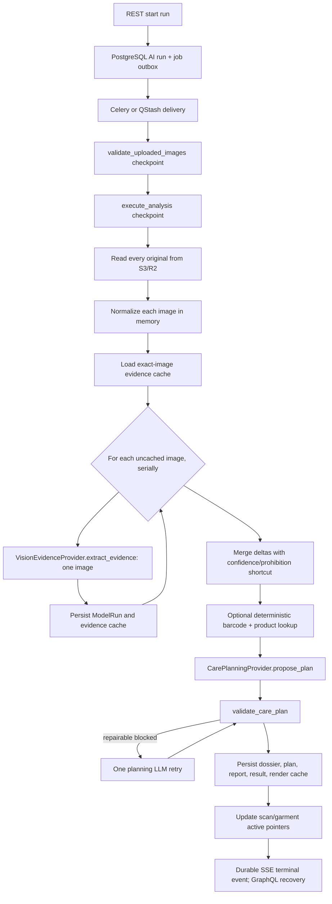
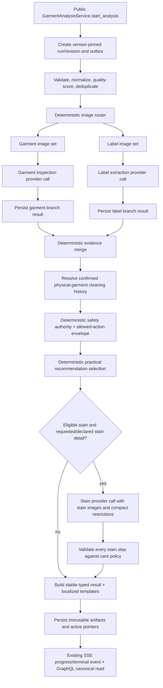

# FabricAssist Garment AI Workflow Implementation Plan

**Status:** repository-grounded implementation plan; no production code is implemented by this document

**Repository baseline inspected:** `fe04b3b` (`v1.3.8`), branch `main`

**Prepared:** 2026-08-03

**Authoritative inputs:** `AGENTS.md`, `docs/requirements.md`, `docs/architecture.md`, current source, migrations, lockfiles, tests, API artifacts, and ADRs

## 1. Executive summary

FabricAssist already has a substantial garment-intelligence implementation, not a greenfield AI feature. It runs as a Python modular monolith with FastAPI and a separate worker entry point, PostgreSQL as the authority, private S3-compatible storage, Celery or QStash dispatch, GraphQL reads, REST commands, and durable SSE run events. The current workflow is concentrated in the 843-line `fabricassist.application.analysis.analyse_scan()` use case, but its behavior is also spread into routes, review lifecycle code, worker composition, provider factories, rendering, and frontend route components.

The current AI call shape does **not** match the proposed target. For an eight-image uncached scan, `analyse_scan()` invokes `VisionEvidenceProvider.extract_evidence()` serially once per image, then invokes `CarePlanningProvider.propose_plan()` once, with one possible planning retry. The Gemini adapter is capable of multi-image input, but the orchestrator normally sends one image at a time. The prompt says to analyze the complete image set even though the caller does not provide it. No garment-inspection/label-extraction branch split or parallelism exists.

The recommended first production design is:

1. Keep the existing modular monolith, job outbox, PostgreSQL domain state, REST/GraphQL/SSE transport split, provider ports, and private object-storage adapter.
2. Create a cohesive garment-analysis bounded module by introducing matching `garment_analysis/` packages under the repository's existing `application`, `domain`, and `infrastructure` layers. Expose only a small application facade.
3. Implement workflow v2 as `AsyncioGarmentAnalysisWorkflow` behind a provider-neutral workflow protocol. Use native structured concurrency inside the existing worker and `analysis_branch_results` as the sole durable execution/business state. Defer LangGraph and its PostgreSQL checkpointer until the workflow crosses the explicit adoption threshold in Section 5.
4. Route normalized images deterministically from their current declared roles. Add an optional typed `viewpoint` (`front`, `back`, `side`, `detail`, `unknown`) instead of replacing the existing stable `garment_overview` role.
5. For a normal label-led scan, make two Gemini multimodal calls in parallel: one garment-inspection call and one label-extraction call. Make a third stain-treatment call only when explicitly justified by a stain image, a detected stain, sufficient image quality, and known care restrictions.
6. Do not use a mandatory final-response or care-policy LLM call in workflow v2. Merge evidence, resolve history, derive the permitted-care envelope, select a recommendation inside that envelope, and render Spanish/English output in deterministic Python. This changes the current mandatory AI-planner decision in ADR-009 and therefore requires a new ADR before implementation.
7. Preserve audit provenance while performing the repository-mandated coordinated contract cutover. Transform retained analyses into the new read projection without rerunning them; do not keep a legacy result reader, API alias, dual write, or old executor.
8. Add branch-level persistence and attempt limits so only a failed branch retries. A model branch gets at most one automatic retry; transport redelivery may continue only to resume durable state, not to exceed the model-attempt cap.
9. Extend the existing `garment_service_events` and `evidence_corrections` concepts rather than adding duplicate history/correction aggregates.

This is the clearest cost-conscious fit for `gemini-2.5-flash` and the Gemini free-tier goal: normally two required calls, zero final-generation calls, and at most one conditional stain call. Free-tier quotas and provider data-use terms are external operational constraints and must be verified before rollout; they are not encoded as assumptions in this plan.

## 2. Current-state repository findings

### 2.1 Verified technology and deployment baseline

| Concern | Repository evidence | Finding |
|---|---|---|
| Python | `.python-version`, `backend/pyproject.toml` | Local pin is Python 3.13; package supports `>=3.12,<3.14`; Ruff/Pyright target 3.12. |
| Backend | `backend/pyproject.toml`, `fabricassist/api/main.py` | FastAPI 0.139.2 lock, Pydantic 2.13.4 lock, SQLAlchemy 2.0.51 lock, Alembic, Strawberry GraphQL. |
| Model SDK | `backend/uv.lock` | Official `google-genai` 1.75.0; no legacy `google-generativeai`. |
| Gemini model | `fabricassist/settings.py`, README | One shared default model: `gemini-2.5-flash`. |
| Alternate model | `infrastructure/vision/providers/openai_responses.py` | Existing OpenAI Responses-compatible adapter implements the same evidence/planning/chat capability set. |
| LangGraph | dependency files and repository search | Not installed and not used. LangChain is also absent. |
| Jobs | ADR-014, application/jobs, infrastructure/jobs | Celery locally; signed QStash in hosted profiles; PostgreSQL outbox/checkpoint rows are authoritative. |
| Production | ADR-015, deployment workflows | Render API, Cloudflare Pages web, Neon PostgreSQL, private Cloudflare R2, QStash, and TLS Valkey. |
| Local | `docker-compose.yml`, README | PostgreSQL/pgvector, Valkey, MinIO, FastAPI, Celery worker. |
| Frontend | package files | Node 24 pin, pnpm 10.28.2, Expo 57, React Native 0.86.2, React 19.2.8, strict TypeScript, Apollo, TanStack Query. |
| Observability | `infrastructure/telemetry.py`, logging | OpenTelemetry FastAPI/Celery instrumentation, OTLP HTTP export, Prometheus metrics, JSON logs, correlation context. No Sentry or Langfuse dependency. |
| API transports | ADR-017 and code | Read-only Strawberry GraphQL for canonical reads; generated REST for writes/uploads/AI commands; durable authenticated SSE for run progress/recovery. |

### 2.2 Existing image lifecycle

- `POST /api/v1/scans/{scan_id}/images` accepts one of the eight `ImageRole` values defined in `domain/evidence.py` and creates a server-owned private key.
- The Expo scan screen already asks the user to choose a role and supports repeated roles, ordering, camera capture, library selection, and up to eight images.
- Upload bytes go directly through a presigned private S3-compatible URL. `S3ObjectStorageAdapter.verify_image()` validates declared/actual MIME, byte size, decodability, dimensions, and a 40-million-pixel ceiling.
- `complete_upload()` computes the original SHA-256 and rejects an exact duplicate within the scan.
- `analyse_scan()` reads originals into memory, applies EXIF orientation, converts to RGB JPEG, thumbnails to 2048×2048, and hashes that derivative. It does not persist a normalized object derivative.
- No implemented blur, brightness, glare, rotation-quality, or role-confidence pipeline exists. `ScanImage.detected_role` exists but is not populated by the current analysis flow and has no confidence column.
- Retention deletes the one stored private object referenced by `ScanImage.object_key`. Tenant schema defaults to 30 days, while runtime/example settings currently default to 7 days; this discrepancy must be resolved as an explicit policy decision.

### 2.3 Existing AI behavior and leakage locations

| Location | Existing responsibility | Encapsulation issue to remove |
|---|---|---|
| `application/analysis.py` | normalization, cache lookup, identity candidates, extraction, product lookup, evidence merge, planning, validation, persistence, rendering | Too many module responsibilities and direct SQLAlchemy access in one use case. |
| `application/lifecycle.py::apply_human_correction` | creates successor revision, calls planner, validates, renders, persists | Duplicates analysis-finalization logic. |
| `api/routes/scans.py` | imports domain AI models and `render_rich_result()` to reconstruct results | Route knows internal canonical layout and rendering implementation. |
| `api/routes/reviews.py` | injects `CarePlanningProvider` directly | Route reaches inside workflow/provider behavior instead of a public analysis service. |
| `worker/tasks.py` and `api/routes/internal_jobs.py` | construct evidence/planning/product providers and pass all workflow internals | Worker boundary knows individual nodes/adapters rather than one module service. |
| `api/main.py` | stores individual evidence/planning providers on app state | Composition root is allowed to wire infrastructure, but consumers should receive one garment-analysis facade. |
| `frontend/.../scan.tsx` | owns role union, guidance, upload loop, analysis start | Garment-analysis feature logic lives in a route file and manually duplicates the role enum. |
| `frontend/.../result.tsx` | manually casts GraphQL JSON into a local `RichResult` | Frontend depends on undocumented JSON fields instead of a stable generated result contract. |
| `domain/evidence.py` | narrow observations/care facts and confidence merge | Cannot represent the requested garment attributes, issue taxonomy, full care fields, provenance authority, or field conflicts. |
| `domain/care.py` | narrow washing/dry-clean validation | Does not cover bleach, tumble drying, natural drying, ironing, wet cleaning, history, preferences, or stain-step validation. |

### 2.4 Existing persistence that should be reused

The schema already has the correct aggregate roots and audit foundations: `scans`, `scan_images`, `ai_runs`, `ai_run_events`, `analysis_job_operations`, `garments`, `analysis_revisions`, `analysis_revision_images`, `garment_observations`, `garment_service_events`, `model_runs`, `garment_evidence_dossiers`, `proposed_care_plans`, `care_validation_reports`, `care_results`, `rendered_answers`, `evidence_corrections`, review records, product lookup records, cache tables, and audit/deletion outboxes. Migration head is `20260731_0022`.

The gaps are branch status/results, rich cleaning-event facts/outcomes, field-level conflict/correction data, quality metadata, workflow/module/retry-policy versions, feature-flag snapshots, and model-run image/attempt metadata.

## 3. Existing AI-analysis flow



Current routine call count for `N` uncached images is `N` evidence calls plus one planning call. A repairable invalid plan adds one more planning call. Barcode decoding is local; Gemini's barcode method currently makes no provider call.

## 4. Proposed AI-analysis flow



`G` and `H` run concurrently only after routing is complete. They write to separate branch records and never share one SQLAlchemy `AsyncSession` concurrently. The workflow gathers provider results, then persists each branch through repository methods/short transactions. If only garment or only label images exist, the missing logical branch returns a typed `not_provided` outcome without spending a model call.

## 5. LangChain/LangGraph decision record

### Graph-engine adoption threshold

This threshold is defined independently of workflow v2. Introduce a graph runtime and durable graph checkpointer only when **either** condition A or condition B is present, and all operational prerequisites are met:

- **A — non-DAG execution:** the production workflow requires a cycle/dynamic fan-out, an autonomous tool loop, or a durable pause that must resume inside the same execution after an external human/system event.
- **B — materially complex static graph:** the production workflow has at least **six independently retryable external-side-effect nodes**, at least **two fan-out/fan-in joins**, and at least one compensation, multi-provider fallback, or long-lived human-review continuation whose state would otherwise require a bespoke execution engine.
- **Operational prerequisites:** graph state can be the sole execution authority or can be committed atomically with business state; tenant ownership, deletion, retention, backup/restore, serializer upgrades, and DDL ownership have passed integration tests; and measured recovery/maintenance value exceeds the extra schema and dependency cost.

Node count alone is not a justification. A static DAG with six simple pure functions still does not qualify, while a smaller cyclic or genuinely long-lived interruptible workflow may qualify under condition A.

### Workflow-v2 evaluation against that threshold

Workflow v2 has three possible provider nodes: two parallel required calls, one conditional stain call, one fan-out/fan-in join, no cycles, no autonomous tool selection, no dynamic fan-out, and no in-process human pause. Corrections and branch reanalysis create a new command/revision and reuse persisted branch artifacts; they do not resume a suspended Python execution. SSE progress is projected from PostgreSQL branch state. Workflow v2 therefore **falls below** the adoption threshold.

This also follows the repository's selected architecture rather than introducing a competing pattern. `docs/architecture.md` Section 14 says the first implementation may use one orchestration task with persisted checkpoints and should split stages only when retries, resource classes, or observability justify it. `application/job_execution.py::execute_checkpoint()` already implements database leases/redelivery around the transport-neutral analysis operation, and `application/job_orchestration.py` already persists the outbox intent before Celery/QStash publication. The missing granularity is a FabricAssist-owned branch row, not a second workflow database.

### Decision

**Implement workflow v2 as `AsyncioGarmentAnalysisWorkflow` behind `GarmentAnalysisWorkflow`. Use `asyncio.TaskGroup` (with branch wrappers returning typed outcomes) or equivalent `asyncio.gather(..., return_exceptions=True)` structured concurrency, and make `analysis_branch_results` the single source of truth for both recovery and business reads. Defer `langgraph`, `langgraph-checkpoint-postgres`, LangChain agents/model wrappers, LangGraph Platform/Server/SDK, and LangSmith.**

This is not a rejection of LangGraph's capabilities. The embedded Functional API supports ordinary Python control flow, parallel tasks, retries, and durable checkpointing ([LangGraph Functional API](https://docs.langchain.com/oss/python/langgraph/functional-api)). Those capabilities become valuable at the threshold above. They do not currently solve a v2 requirement that the existing worker, outbox, and a branch-state table cannot solve with less state and operational risk.

### Mid-fan-out crash analysis

Assume both provider requests are initiated at `t=0`, garment inspection returns at `t=2.0s`, its domain result is committed, label extraction remains in flight, and the worker dies at `t=2.2s`. Gemini does not currently provide FabricAssist with a general exactly-once/idempotency guarantee for these calls.

#### Scenario A — LangGraph plus `AsyncPostgresSaver`

1. The first delivery starts two Gemini calls.
2. Garment inspection completes and `analysis_branch_results` is committed. A LangGraph task/pending-write checkpoint may also be saved, but that is a separate write boundary.
3. The crash abandons the unfinished label task. Gemini may already have accepted and processed that request even though FabricAssist has no result.
4. On redelivery, a saved LangGraph task result can restore inspection. If its checkpoint was not committed, the task must still consult the completed domain branch row to avoid calling Gemini again; without that domain idempotency check, LangGraph can duplicate inspection across the domain/checkpoint transaction window.
5. Label extraction has no completed result and is invoked again, subject to the branch attempt cap.

**Calls:** first delivery makes 2 application-level Gemini invocations; second delivery makes 1 label invocation; total is **3 invocations**. There are **0 duplicate calls for the committed inspection branch**, but there may be **1 duplicate provider execution for the unfinished label request**. A checkpointer cannot make an in-flight external request exactly once.

#### Scenario B — native asyncio plus `analysis_branch_results`

1. The first delivery atomically claims both branch rows/attempts and starts two Gemini calls.
2. Inspection completes; its typed payload, status, model-run metadata, and durable progress/outbox event are committed in one short branch transaction.
3. The crash leaves label as `running` with an expired/stale lease and no completed payload.
4. On redelivery, the orchestrator loads both rows, skips the completed inspection branch, atomically reclaims label as attempt 2, and calls only label extraction.
5. The deterministic join runs only after it loads the required completed/not-provided outcomes from PostgreSQL.

**Calls:** first delivery makes 2 application-level Gemini invocations; second delivery makes 1 label invocation; total is **3 invocations**. As in scenario A, there are **0 duplicate calls for inspection** and potentially **1 duplicate provider execution for the unfinished label request**. If the first label request never reached Gemini, provider-side work totals two calls rather than three, but FabricAssist still records three invocation attempts.

The scenarios have the same safe replay and duplicate-call behavior. The dedicated checkpoint table supplies no additional recovery fact needed by this static DAG: the completed branch payload, attempt budget, status, versions, timestamps, and next eligible action already exist in the domain row.

### Dual-state and transaction analysis

`AsyncPostgresSaver` and the module repositories do not share one application transaction by default. Two crash windows follow:

- **Domain commit first, checkpoint second:** the branch is safely complete for users, but the graph may replay the task. Avoiding the duplicate requires the task to read `analysis_branch_results`; the domain state already provides recovery.
- **Checkpoint first, domain commit second:** the graph may regard the task as complete while public/business state has no branch result. Recovery needs reconciliation/promotion code, and a defect can leave graph execution ahead of the authoritative result.

Trying to synchronize both stores adds a two-state invariant without removing the existing domain persistence requirement. Native asyncio has one transition boundary per branch and no promotion/reconciliation path. `analysis_branch_results` uses tenant/revision foreign keys, normal status/version columns, and the existing audit/outbox transaction patterns.

Opaque MessagePack/JSON checkpoint blobs also weaken lifecycle operations. They do not naturally expose `tenant_id` or analysis foreign keys for SQL cascade, retention queries, legal holds, or audit counts. Tenant deletion would require a custom thread-ID lookup/deletion step, serializer-version-aware cleanup, orphan scans, and tests that blobs do not outlive domain rows. Normal branch rows participate in existing foreign-key cascades and deletion-outbox verification. This is avoidable GDPR/retention complexity for v2.

### Concrete requirement breakdown

No v2 requirement breaks native asyncio plus PostgreSQL domain state:

| Requirement | Native implementation |
|---|---|
| Parallel fan-out/join | Start two wrapped coroutines in one `TaskGroup`; each receives immutable inputs and persists through its own short repository transaction. |
| Branch-scoped retry | `analysis_branch_results.attempt_count`, status, retry eligibility, and an atomic claim enforce initial plus one retry for only that branch. |
| Worker crash/redelivery | Reload branch rows; skip `completed`/`not_provided`; reclaim only stale retryable work. |
| Conditional stain | Evaluate the deterministic eligibility predicate after merge/policy; call the stain coroutine only when true. |
| Branch reanalysis | Create a successor revision/branch command, copy/reference the successful sibling artifact, run only the requested branch, then remerge and revalidate. |
| Human corrections | Persist immutable correction overlays/successor revisions and dispatch a new deterministic finalization; no suspended execution is required. |
| SSE progress | Publish existing durable `AiRunEvent` records from committed branch transitions; GraphQL reads the same branch projection. |
| Partial failure | Persist typed branch failure/needs-input outcomes and derive `partially_completed`, `needs_input`, or `failed` from the rows. |

The orchestrator must not attempt to implement generic replay. It performs a small fixed algorithm: load/claim eligible rows, run up to two provider coroutines, load durable outcomes, merge/policy, optionally run stain, and finalize. PostgreSQL/outbox state—not in-memory task state—determines every resume decision.

### Why not LangChain for providers

LangChain's high-level value is agent harnesses, model integrations, tools, and agent loops; its agents are built on LangGraph ([LangChain overview](https://docs.langchain.com/oss/python/langchain/overview)). Garment analysis is a predetermined typed workflow, not an autonomous tool-selection loop.

`ChatGoogleGenerativeAI` supports native async, multimodal input, token metadata, and Gemini-native JSON Schema structured output ([Google integration](https://docs.langchain.com/oss/python/integrations/chat/google_generative_ai)). However, FabricAssist still needs its application adapter for task-specific requests, source-image validation, domain Pydantic and semantic validation, stable errors, privacy-safe usage, and provider-object isolation. Replacing the direct adapter would add `AIMessage`/`Runnable` objects without removing that boundary. Retain `GarmentVisionProvider` and direct Gemini/OpenAI implementations; reevaluate a LangChain-backed infrastructure adapter only when multiple providers demonstrate measured maintenance value.

### Native task shape and state authority

```text
FastAPI REST command
    -> GarmentAnalysisService
    -> existing PostgreSQL outbox/job
    -> existing Celery or QStash worker
    -> AsyncioGarmentAnalysisWorkflow.execute/resume(...)
    -> provider ports/domain services/repositories
```

- `analysis_branch_results` is the sole durable execution and business-read authority for branch status/output. `model_runs` remains the immutable invocation/usage audit.
- Each branch has one row per revision enforced by unique `(revision_id, branch_name)`; branch reanalysis creates a successor revision rather than overwriting the original output.
- Atomic compare-and-set/row-lock transitions claim pending or stale retryable work and increment the attempt number before the external call. The branch result/error, corresponding `model_runs` completion, and durable progress/outbox event must commit in one repository-owned transaction; if current helpers cannot share that unit of work, Phase 4 refactors the boundary rather than accepting drift.
- No SQLAlchemy `AsyncSession` is shared by concurrent tasks. Provider calls operate on immutable values; each persistence action opens its own short unit of work.
- QStash/Celery remains the outer delivery, lease, and recovery system. An unfinished external call is at-least-once, not exactly-once; request fingerprints and provider idempotency keys should be used when a provider supports them, but the plan does not claim an unavailable guarantee.
- Pure merge, history, policy, and final rendering may be recomputed safely from completed immutable branches. Their final persisted artifacts and active-pointer transition remain idempotent.

### ADR impact

Phase 0 should create `docs/adr/019-garment-analysis-module-and-async-workflow.md`. It records native asyncio orchestration, the graph-engine adoption threshold, branch-state authority, crash semantics, and the v2 decision to remove the mandatory care-planning LLM call. The latter refines ADR-009: typed proposal/validation/audit artifacts remain, but the canonical base plan is deterministically derived and only optional stain proposals are model-generated. ADR-009 must not be silently contradicted.

## 6. Proposed backend module boundary

The repository uses horizontal clean-architecture layers, so do not invent a top-level `modules/` tree. Create a matching `garment_analysis/` package inside each existing layer and make `fabricassist.application.garment_analysis` the only supported entry point for API/worker consumers.

```text
backend/src/fabricassist/
├── application/garment_analysis/
│   ├── __init__.py                 # exports public commands/results/service protocol only
│   ├── service.py                  # facade implementation
│   ├── commands.py
│   ├── queries.py
│   ├── ports.py                    # workflow, provider, repositories, image assets
│   ├── settings.py                 # module-owned non-secret policy snapshot
│   ├── orchestration/
│   │   └── asyncio_workflow.py     # native structured-concurrency v2 implementation
│   └── prompts/
│       ├── registry.py
│       └── v1/{garment_inspection,label_extraction,stain_treatment}.txt
├── domain/garment_analysis/
│   ├── models.py
│   ├── image_routing.py
│   ├── evidence_merge.py
│   ├── cleaning_history.py
│   ├── care_policy.py
│   ├── conflicts.py
│   └── stain_policy.py
└── infrastructure/garment_analysis/
    ├── persistence.py              # SQLAlchemy repository adapters
    ├── images.py                   # object-store reads/normalization/quality adapter
    ├── providers/
    │   ├── gemini.py
    │   ├── mock.py
    │   └── openai_responses.py
    └── observability.py
```

This is one bounded module expressed through existing repository layers. Domain code remains free of FastAPI, SQLAlchemy, Google SDK, graph-runtime objects, worker objects, and settings. The public facade delegates to ports; infrastructure implements ports. Architecture tests enforce that external code imports only `fabricassist.application.garment_analysis` and never its internal orchestration/provider modules.

### Internal dependency direction

```text
FastAPI routes / Strawberry query adapters / worker delivery adapters
                  ↓
fabricassist.application.garment_analysis public facade
                  ↓
workflow protocol + native asyncio workflow
          ↓                       ↓
domain garment-analysis services  application ports
                                  ↑
                   infrastructure adapters
```

No domain service executes SQL. No API route or worker task interprets provider output, merges evidence, applies policy, or renders an analysis.

## 7. Public module interfaces

Names below match current service/port conventions while preserving current `scan_id`, `run_id`, and `AnalysisRevision` concepts.

```python
class GarmentAnalysisService(Protocol):
    async def start_analysis(
        self, command: StartGarmentAnalysis
    ) -> AnalysisReference: ...

    async def get_analysis(
        self, query: GetGarmentAnalysis
    ) -> FabricAssistAnalysisResult | AnalysisProgress: ...

    async def resume_analysis(
        self, command: ResumeGarmentAnalysis
    ) -> AnalysisProgress: ...

    async def reanalyze_branch(
        self, command: ReanalyzeAnalysisBranch
    ) -> AnalysisReference: ...

    async def record_cleaning_event(
        self, command: RecordGarmentCleaningEvent
    ) -> CleaningEvent: ...

    async def record_user_correction(
        self, command: RecordAnalysisCorrection
    ) -> AnalysisReference: ...
```

- `start_analysis` replaces direct route coordination of `create_analysis_run()` and `enqueue_analysis()`.
- `resume_analysis` is the worker/QStash entry and is idempotent from persisted branch state.
- `get_analysis` is used by a module-owned query adapter; GraphQL may continue using the broader `StorefrontQueryPort`, but it must receive stable module views, not raw ORM/JSON internals.
- `reanalyze_branch` accepts only stable `AnalysisBranch` values: `garment_inspection`, `label_extraction`, and `stain_treatment`.
- `record_user_correction` creates an overlay/successor revision; it never mutates original model output.
- `AnalysisReference` contains current public identities (`scan_id`, `run_id`) and internal revision identity where available. Existing REST responses need not expose a new field immediately.

### Workflow strategy abstraction

```python
class GarmentAnalysisWorkflow(Protocol):
    async def execute(self, request: GarmentAnalysisRequest) -> WorkflowResult: ...
    async def resume(self, request: ResumeWorkflowRequest) -> WorkflowResult: ...
    async def reanalyze_branch(
        self, request: BranchReanalysisRequest
    ) -> WorkflowResult: ...
```

Only `AsyncioGarmentAnalysisWorkflow` is created for v2. The protocol returns provider-independent artifacts and stable errors, not asyncio task objects, SQLAlchemy entities, or transport responses. LangGraph may later implement the same protocol only after the Section 5 threshold and ADR gate are met; it is not a v2 dependency or a second implementation now.

## 8. Provider-adapter boundary and Gemini design

### 8.1 Provider port

```python
class GarmentVisionProvider(Protocol):
    @property
    def descriptor(self) -> ProviderDescriptor: ...

    async def inspect_garment(
        self, request: GarmentInspectionRequest
    ) -> ModelInvocation[GarmentInspection]: ...

    async def extract_labels(
        self, request: LabelExtractionRequest
    ) -> ModelInvocation[LabelExtraction]: ...

    async def analyze_stain(
        self, request: StainTreatmentRequest
    ) -> ModelInvocation[StainTreatment]: ...
```

The existing `VisionEvidenceProvider` is migrated into this task-specific port. The existing provider descriptor, error categorization, mock default, Gemini adapter, OpenAI Responses adapter, credential isolation, and capability factory patterns are retained. Conversation remains a separate capability.

### 8.2 Gemini adapter responsibilities

The module's Gemini adapter must:

- use the installed `google.genai.Client` async API;
- send normalized inline JPEG bytes, as today; remote signed URLs are not sent;
- convert stable internal requests into alternating ID/role/viewpoint metadata parts and image parts;
- request `application/json` with a branch-specific response JSON schema and temperature zero;
- keep `google.genai.types`, response candidates, usage objects, SDK exceptions, API keys, and HTTP options private;
- validate response JSON with Pydantic a second time;
- validate every source image ID against the exact routed request;
- run semantic validation (percent totals, forbidden cross-fields, observed/inferred rules, uncertainty, care-symbol consistency) after schema validation;
- map 429, authentication, not-found, 5xx, timeout/network, safety rejection, truncated output, and malformed structured output into internal error categories;
- return `ModelInvocation[T]` containing the typed value, provider/model identifiers, response ID/model version when safe, latency, usage, and attempt number.

The current code creates/closes a Gemini client per call. Keep that behavior initially unless profiling proves client reuse is safe across the worker's event-loop/process lifecycle.

### 8.3 Structured output and DTO choice

Use the provider-independent Pydantic branch contracts directly as Gemini response contracts at first. Do **not** add a second DTO/mapping layer merely for symmetry. Add adapter-local response DTOs only if contract tests show that Gemini's supported JSON Schema subset cannot represent required domain validation. In that case, map inside `infrastructure/garment_analysis/providers/gemini.py`; Gemini compromises must not alter domain types.

### 8.4 Usage metadata verified from installed SDK

`GenerateContentResponseUsageMetadata` in installed `google-genai` 1.75.0 exposes `prompt_token_count`, `candidates_token_count`, `total_token_count`, `cached_content_token_count`, `thoughts_token_count`, `tool_use_prompt_token_count`, and per-modality token detail collections. Current FabricAssist persists only prompt/candidate counts. Workflow v2 should capture total/cached/thought/tool counts when present and preserve `None` when unavailable. Promotion must test actual model responses because availability can vary by model/API path.

## 9. Pydantic/domain model design

All external/provider boundary models use `ConfigDict(extra="forbid")`, bounded text/list sizes, explicit enums, confidence `0..100`, UUID source references, and explicit unknown states.

### 9.1 Evidence value pattern

Use typed values plus separate field evidence, rather than wrapping every scalar in an unwieldy generic that may complicate provider schemas:

```python
class FieldEvidence(BaseModel):
    field_path: str
    source_kind: EvidenceSourceKind
    source_image_ids: list[UUID]
    certainty: Literal["observed", "inferred", "confirmed", "unknown"]
    confidence: int
    original_text: str | None = None
    uncertainty_reason: str | None = None
```

Branch values remain easy to query, while `field_evidence` supplies per-field authority, confidence, and provenance. Model validators require evidence for every non-unknown safety or material field.

### 9.2 Garment inspection

`GarmentInspection` contains category/subtype, colors, pattern, features, visual material hypotheses, issue list, overall condition, overall confidence, uncertain fields, and `field_evidence`. It must not contain label-confirmed materials. A visual material is always an inference.

`GarmentIssue` uses the requested types (`stain`, `hole`, `tear`, `loose_seam`, `pilling`, `fading`, `discoloration`, `deformation`, `stretching`, `missing_part`, `other`), severity, location, observed description, confidence, source IDs, and optional cause hypothesis. Cause is modeled as `suspected_causes: list[CauseHypothesis]`; `confirmed_cause` is populated only from user/human/verified evidence, never from appearance alone.

### 9.3 Label extraction

`LabelExtraction` separates exact visible text entries per image from normalized materials and typed instructions. Each care category uses permission `allowed | prohibited | restricted | unknown` plus category-specific limits. It covers wash permission/temperature/process, bleach type, tumble-dry heat, natural drying, ironing temperature/steam, dry-clean process/severity, professional wet-clean severity, warnings, uncertain symbols, sources, field evidence, and overall confidence.

Material percentages remain nullable; a validator accepts a configured rounding tolerance and otherwise records a conflict/uncertainty rather than normalizing totals silently.

### 9.4 Merged/policy/result models

- `MergedGarmentAssessment`: immutable branch references, selected facts, all source observations, conflicts, uncertainties, and revision metadata.
- `CarePolicy`: allowed actions, prohibited actions, maximums/restrictions, professional-only processes, evidence/reason references, warnings, outcome, and `care_policy_version`.
- `CareRecommendation`: the deterministic selection inside `CarePolicy`, including history/preference source and explanation keys.
- `StainTreatment`: immutable provider proposal with typed steps, hypotheses, sources, confidence, and uncertainty.
- `ValidatedStainTreatment`: accepted claim IDs, blocked claim IDs/conflicts, outcome, and policy version; it does not mutate the provider proposal.
- `FabricAssistAnalysisResult`: stable canonical result with garment inspection, label facts, policy, recommendation, optional validated stain guidance, conflicts, uncertainties, clearer-image requests, versions, and localization-template inputs.

## 10. Image routing and quality design

### 10.1 Stable image metadata

Retain the existing eight `ImageRole` values. Add an optional `viewpoint` for `garment_overview`/`construction_detail`: `front`, `back`, `side`, `detail`, `unknown`. This obtains explicit front/back routing without deprecating existing `garment_overview` data or adding overlapping `garment_front` aliases.

`care_label` and `composition_label` remain repeatable. If one photo visibly contains both, the client may upload it once with a new optional `label_scope=combined`; the primary role remains the user's best declared role and the router may include the same image in the one label branch without duplicating provider transmission.

Existing records need no role backfill. Their `viewpoint`/`label_scope` is `unknown`; `garment_overview` remains eligible for inspection and both current label roles remain eligible for extraction. `other` is the stable unknown-role fallback.

### 10.2 Deterministic branch selection

| Branch | Include | Exclude by default |
|---|---|---|
| Garment inspection | overview front/back/side; construction detail; damage close-up; stain close-up needed to detect/locate condition | care/composition/barcode labels; unrelated `other` |
| Label extraction | care label; composition label; combined label-scope images | garment overview, damage, stain, barcode-only |
| Stain treatment | relevant stain close-ups; at most one contextual overview; compact typed composition/policy/history context | all labels as images, unrelated damage, barcode, redundant overviews |

Garment attributes and condition stay in one call because they use the same garment views. Do not split them until evaluation proves enough accuracy gain to justify retransmitting front/back images.

### 10.3 Unknown roles

1. Trust explicit client role unless impossible metadata or user correction says otherwise.
2. For existing `other`, use deterministic hints only when safe (user caption/viewpoint/known upload step).
3. Do not spend a standalone classification call.
4. If an `other` image cannot be routed, preserve it but exclude it from model calls and ask the user to identify it.
5. A later provider call may report a detected role incidentally, but that never silently changes the declared role; persist both and surface mismatch for correction.

### 10.4 Quality/preprocessing

Add local resolution, blur, brightness, contrast, probable glare, rotation/orientation, and crop-readability signals. Preserve the original. Create branch-specific derivatives: garment maximum dimension around the current 2048 baseline; label/stain crops retain enough resolution for symbols or fibers. Strip EXIF by re-encoding. Persist normalization/preprocessing versions and derivative keys if derivatives are retained. Reject unusable images before provider calls; warn rather than over-reject borderline garments.

## 11. Deterministic evidence merging and conflicts

`EvidenceMerger` is a pure domain service. It receives original branch results, prior stable evidence, catalog/manufacturer evidence, accepted correction overlays, and user statements. It never queries repositories.

Authority is field-specific:

**Safety authority:** explicit photographed written prohibition > photographed normalized prohibition/symbol > explicit photographed limit > verified manufacturer matching exact variant > conservative deterministic safety rule. A prohibition wins over permission at the same or weaker source.

**Composition/factual authority:** photographed composition label > exact verified manufacturer information > accepted human/user factual correction > reliable visual observation > visual inference. User correction cannot claim a photographed prohibition is absent without review/new image evidence.

**Practical preference inside the safety envelope:** verified successful cleaning history > user-confirmed preference > validated optional model suggestion > generic textile guidance.

The merger preserves unknown, never treats missing as allowed, retains both conflicting observations, and emits `EvidenceConflict` with field path, values, sources, selected value, resolution code, and localized explanation key. Example: visual `wool-like` remains an inference while a `100% acrylic` composition label becomes the selected material.

Conflicts that can affect permission/limits force `needs_better_image` or `needs_review`; they are not resolved solely by numeric confidence.

## 12. Deterministic care-policy design

Implement small typed Python rule objects/decision tables inside `domain/garment_analysis/care_policy.py`; do not add a rules-engine dependency. A registry selects an immutable policy implementation by `care_policy_version`, and repository assets/checksums follow the existing `care_policy_v1.json` pattern.

Separate three operations:

1. `derive_safety_envelope(assessment) -> CarePolicy`: computes allowed/prohibited/unknown actions and numeric/process limits.
2. `resolve_practical_preference(policy, history, preferences) -> CareRecommendation`: selects only within the envelope.
3. `validate_candidate_claims(policy, claims) -> ClaimValidationReport`: gates optional stain or chat claims without rewriting their proposal.

Cover washing, machine/hand wash, temperature/process, bleach/chlorine/oxygen bleach, tumble dry/heat, natural drying, ironing/temperature/steam, dry cleaning/process, professional wet cleaning, detergent eligibility, sensitive materials, contradictions, and professional-only handling.

The deterministic base recommendation replaces the mandatory v2 care-planning LLM call. It may produce conservative `unknown`/review rather than invent missing permission. Stable localized templates render it; `final_llm_response_enabled` remains false. An optional future explanation model can consume only validated claims and may not change codes or values.

## 13. Cleaning history model

Extend `GarmentServiceEvent`; do not introduce a competing history table. Keep lifecycle `kind` (`planned`, `performed`, `completed`) and add normalized fields for method, water temperature, cycle, detergent category/text, stain products, drying method, ironing method, outcome, observed effects, actor/source confirmation, occurred/cleaned time, and a versioned detail JSONB snapshot for evolving non-safety notes.

History is eligible only when:

- the scan is linked to the exact/previously confirmed physical garment, never merely the same product;
- the event is performed/completed;
- outcome is `successful` for positive preference influence;
- damaging outcomes become negative constraints/warnings, not recommendations;
- the event is not invalidated/superseded;
- the proposed reuse remains inside current label/manufacturer/deterministic limits.

An apparently successful 40°C/tumble event never overrides a 30°C/no-tumble label. Persist two conflicts selecting 30°C and no tumble. One successful event has lower weight than repeated successful events but can never acquire safety authority through repetition.

Initially preserve current operator/admin confirmation rules. Whether customers may create a distinct `user_reported` performed event is an open product/authorization question; do not weaken `cleaned_before` semantics implicitly.

## 14. User-correction model

Reuse append-only `EvidenceCorrection` and successor `AnalysisRevision` behavior. Expand corrections with `field_path`, previous/corrected JSONB values, optional source image ID, correction source (`customer`, `operator`, `system`), reason, confirmation state, and supersession metadata. Original branch payloads and original results remain immutable.

- Customers may correct descriptive attributes, issue location/type, known stain cause, and user-owned history/preference facts.
- Customers may flag a care-symbol/material extraction as wrong, but a safety-critical correction requires a clearer image or operator review before it becomes authoritative.
- Operators may create reviewed human evidence overlays.
- Reanalysis creates new model branch results; accepted correction overlays remain active until explicitly superseded by new photographed evidence plus reviewed conflict resolution. A model retry never automatically overwrites a correction.
- Each correction triggers deterministic remerge/repolicy and a successor revision. It must not call an API-route-level planner.

## 15. Conditional stain analysis

The initial trigger should be conservative and cost-aware. Run the stain branch only when all are true:

1. At least one usable `stain_closeup` was explicitly supplied or the user explicitly requests stain treatment.
2. Garment inspection reports a relevant stain linked to one of those images.
3. Critical care restrictions are known with configured confidence, or the system can return only a nonactionable request for better evidence.
4. The stain branch feature is enabled for the pinned workflow version.
5. No existing equivalent successful branch result is reusable.

The request includes the relevant issue, one or more stain images, at most one contextual overview, confirmed materials (or clearly marked visual inference only if no confirmed composition), policy restrictions, user-confirmed cause/age, successful/damaging treatment history, and locale only if the schema truly needs localized text.

The provider returns typed proposed steps. The policy validator marks every step accepted or blocked. Blocked bleach/heat/wash/solvent steps remain in the immutable proposal and conflict report but never in actionable output. A pre-authored safer template may ask for professional help or better evidence; it is not represented as a rewritten model proposal.

## 16. Retry and error-handling strategy

### Branch attempt policy

- Maximum two model invocations per branch: initial plus one automatic retry.
- Persist an attempt row before invocation and result/error afterward so worker redelivery cannot exceed the cap.
- Retry only the failed/uncertain branch; never restart a completed sibling.
- Provider timeout, network, 429, and categorized 5xx may retry with exponential backoff/jitter.
- Malformed/schema-invalid output may retry once with the same images and a constrained repair instruction.
- Low-confidence labels may retry once after local rotate/crop/contrast enhancement; the original remains preserved.
- Do not retry deterministic policy failures, prohibited advice, invalid source IDs, missing images, or user-correctable role ambiguity blindly.
- A retry does not raise confidence by itself. Persist initial/retry confidence separately.

Current Celery/QStash transport retries may continue to redeliver the job, but the orchestrator reads persisted branch attempts before invoking a provider. Transport retry count and model attempt count are different metrics. This bounds calls but cannot guarantee exactly-once execution for a provider request that was in flight when the worker died.

### Confidence thresholds

Use branch- and field-specific thresholds stored in the versioned retry/confidence policy. Critical label permission/temperature fields require the highest threshold; composition percentages and warnings are high; garment subtype/colors/features may be lower. Threshold failure yields `unknown`, `needs_better_image`, or review—not a fabricated value.

### Partial failure semantics

- Label success + garment-inspection failure: care-label policy may complete with condition unavailable and no stain guidance, if all safety facts are sufficient.
- Garment success + absent/low-confidence label: return inspection observations but no authorization to wash/dry clean; request a clearer label.
- Exhausted provider failure: `failed` with stable provider category, not `needs_better_image`.
- Low-confidence image success: `needs_better_image`, not provider failure.
- Keep current scan status enum where possible; expose stable branch summaries within analysis progress rather than every internal orchestration stage.

## 17. Token/request optimization and concrete call comparison

### Representative eight-image scan

Assume two overview images, two label images, one stain close-up, one damage close-up, one construction detail, and one barcode image.

| Strategy | Routine Gemini calls | Images transmitted | Retry blast radius | Repository fit |
|---|---:|---:|---|---|
| Current implementation | 8 evidence + 1 planner = 9 | 8 image transmissions; planner gets JSON only | Evidence error is per image; invalid plan adds a tenth call | Actual code today; serial and loses cross-image reasoning. |
| One combined call | 1 | All 8 | Any failure/uncertainty resends all 8 | Lowest request count but mixed-task schema, unrelated barcode image, weaker branch retry/measurement. Not recommended. |
| Proposed required branches | 2 | Garment: up to 5 relevant images; labels: 2; barcode excluded = up to 7 | Retry only 5 garment or 2 label images | Recommended normal label-led path; branches run in parallel. |
| Proposed with stain | 3 | Required 7 + stain branch 1 stain and optional 1 context = up to 9 transmissions | Retry only 1–2 stain images | Conditional; a stain image may be transmitted twice for detection then treatment. |

Actual image-token consumption cannot be responsibly predicted from file count alone. Resolution, provider image-token calculation, prompt/schema size, and modality details matter. Measure using installed SDK usage metadata. The v2 hypothesis is lower prompt overhead and fewer irrelevant images than current per-image calls, plus much smaller retries than one combined request. Acceptance requires fixture measurements rather than a claimed percentage.

For an auditable expectation, let `I(S)` be Gemini's measured image-input tokens for image set `S`, `P_x` the prompt/schema/context tokens for operation `x`, and `O_x` its output tokens. The representative uncached scan has these token shapes:

- current: `sum(P_evidence + I(one image) + O_evidence)` across eight images, plus `P_planner(dossier) + O_planner`, plus the planner term again on repair;
- proposed required: `P_garment + I(five routed images) + O_garment + P_label + I(two routed images) + O_label`;
- proposed stain path: the proposed-required term plus `P_stain(compact context) + I(one stain + at most one overview) + O_stain`;
- combined alternative: `P_combined + I(all eight images) + O_combined`, but the complete term repeats on retry.

Therefore v2 is expected to transmit one fewer unique image in the normal representative path, repeat prompt/schema overhead twice rather than eight times, and remove the mandatory JSON-only planning term. The two richer branch outputs may be larger than two current deltas, so this remains a measured hypothesis. A label retry resends at most two label images and a garment retry at most five garment images; this is a larger image retry than current single-image extraction but preserves cross-image reasoning and avoids rerunning the successful sibling. Promotion criteria must compare actual `total_token_count`, quality, and retry incidence on the same fixtures.

Optimization order: exact normalized SHA reuse; deduplicate within branch; route by role; crop/rotate label/stain derivatives; resize without losing symbols/damage; exclude barcode/other; limit contextual overview to one in stain analysis; then evaluate pHash candidates. Never let pHash or aggressive compression replace a safety-relevant symbol.

## 18. Workflow, prompt, schema, policy, and feature versioning

Persist on every revision/result where material:

- module version;
- workflow version (initial new implementation `garment-analysis-v2`; transformed historical rows retain their actual/origin version metadata);
- branch provider/model/prompt/schema/preprocessing versions;
- merged-assessment schema version;
- care-policy, confidence-policy, retry-policy, stain-policy, and template versions/checksums;
- materially effective feature flags;
- run/revision creation time and branch start/completion times.

Prompts live as reviewed package text assets under the module, loaded through a registry that verifies version/checksum. Do not build a database prompt-management platform. Provider-tailored schema/prompt adjustments remain adapter-local and are separately versioned.

At start, configuration chooses the workflow version and records it on the run/revision. In-progress work always resumes its pinned version even if deployment settings change. No endpoint is duplicated for v2.

## 19. Configuration and dependency injection

Extend `Settings` only with global deployment selectors/secrets; convert them at `api/main.py` and worker composition roots into a non-secret module settings snapshot. Recommended settings:

- active garment-analysis workflow version;
- active vision provider;
- branch-specific model overrides with existing `gemini_model` as the initial default source;
- prompt/schema/preprocessing/policy/retry/template versions;
- maximum branch retries fixed/defaulted to one;
- branch and critical-field thresholds;
- garment/label/stain image limits and timeouts;
- stain-analysis trigger mode;
- final LLM response disabled;
- garment-analysis activation gate disabled before the coordinated cutover; in production, disabled means no new analysis/fail readiness rather than legacy fallback;
- offline/test comparison sampling disabled by default.

Do not pass global `Settings` into domain/application services. `api/main.py` creates one `GarmentAnalysisService` facade and places that on app state. Workers create the same facade from settings. Routes and job handlers inject only the facade. Remove current evidence/care provider selectors and old workflow wiring in the coordinated cutover; the activation gate must never select them as fallback.

## 20. Repository and persistence boundaries

Define minimal module ports aligned with current application protocols:

- `AnalysisRepository`: create/load revision, load branch state, atomically claim branch attempt, save branch result/error, save merged/policy/final artifacts, activate result.
- `CleaningHistoryRepository`: list eligible exact-garment events and append event.
- `CorrectionRepository`: list active overlays and append/supersede correction.
- `ImageAssetRepository`: load authorized metadata/bytes and save derivative metadata; object storage remains behind its adapter.
- `ModelRunRepository`: record invocation metadata/usage.
- `RunEventPublisher`: append current durable `AiRunEvent` progress/terminal events; no new event bus.

Domain merge/policy functions receive values from these ports. SQLAlchemy models never cross into domain. Avoid generic repository CRUD and avoid duplicating the existing `StorefrontQueryPort`; the latter remains the broader read model but consumes module projections for analysis results.

## 21. Database and migration changes

Use additive migrations from current head `20260731_0022`; never edit applied revisions.

### 21.1 Normalized columns/tables

1. `scan_images`: add nullable `viewpoint`, `label_scope`, `detected_role_confidence`, `quality_state`, `quality_version`, `quality_signals JSONB`, `normalization_version`, and optional normalized/branch-derivative object keys. Index only fields used for routing/operational queries.
2. `analysis_revisions`: add non-null/backfilled `module_version`, `workflow_version`, merged schema, care/confidence/retry policy versions, materially effective flags JSONB, and finalized timestamp. Backfill current records as `garment-analysis-v1` with the versions embedded in current canonical artifacts when available.
3. New `analysis_branch_results`: tenant/revision, stable branch enum, status (`pending`, `running`, `completed`, `retryable_failed`, `permanent_failed`, `needs_input`, `not_provided`), attempt count, claim/lease timestamps, provider/model/prompt/schema/preprocessing versions, request fingerprint, overall confidence, uncertain fields JSONB, result payload JSONB, error category, and started/completed timestamps. Enforce unique `(revision_id, branch_name)`; successor reanalysis uses a new revision instead of overwriting the original. This table is the sole durable branch execution and business-read authority.
4. `model_runs`: add nullable revision/branch result IDs, retry number, image count, role-count JSONB, total/cached/thought/tool token counts, response/model version metadata, and completed timestamp. Keep provider payloads and secrets out.
5. `garment_service_events`: add the normalized cleaning method/limits/outcome/source/timestamps described above plus details JSONB. Existing events backfill to unknown detail values; their `kind` and `cleaned_before` behavior remain valid.
6. `evidence_corrections`: add field path, previous/corrected values, source image, correction source/state, and supersedes reference while retaining current full correction JSONB.
7. New `evidence_conflicts`: tenant/revision, field path, historical/authoritative/selected values JSONB, source codes, resolution code, explanation key, safety-critical boolean, created timestamp.
8. Extend `ruleset_versions.ruleset_type` or introduce a general `behavior_versions` table for workflow/prompt/schema/confidence/retry/stain versions. Prefer a general immutable registry because current check constraint only allows care/detergent/rendering.

### 21.2 JSONB versus relational storage

- Keep complete branch outputs, merged dossier, policy, and final canonical snapshots in JSONB for immutable audit/read compatibility.
- Keep execution state and branch output together in FabricAssist-owned branch rows; do not create serialized framework checkpoint blobs or a promotion/reconciliation path.
- Normalize status, authority, method, outcome, temperature, branch, versions, provider/model, attempt, tokens, times, and conflict field path because policy/operations query them.
- Source-image links that require referential integrity should use association rows or validated UUID arrays with an explicit decision; do not rely only on unvalidated strings inside JSONB.
- Do not normalize every descriptive color/feature until a demonstrated query requires it.

### 21.3 Retained-data transformation and rollback

- Do not rerun old analyses. Transform retained `care_results.canonical_data`, rendered data, and image-role values into the new canonical projection in a bounded migration; preserve immutable source snapshots/audit fields only where the approved schema explicitly retains them.
- Backfill workflow/version columns from embedded artifacts; use `unknown` only when the historical artifact genuinely lacks a version, and record the transformation version.
- Map or reject obsolete image roles explicitly during the coordinated cutover; do not retain deprecated aliases in the domain/API.
- Existing service events transform to the new typed shape with honest unknown details where deterministic mapping is unavailable.
- Use expand/transform/verify/contract inside the coordinated release/migration sequence, but do not leave dual readers/writers or obsolete columns/tables active afterward.
- Branch rows use tenant/revision foreign keys and participate in the existing deletion/retention outbox and cascade verification; no custom checkpoint-thread cleanup is required.
- Rollback is forward-fix or verified backup restore; do not keep an old executor solely to simplify rollback.

## 22. Backend API and transport changes

### Preserve

- REST writes/commands, GraphQL canonical reads, and durable SSE from ADR-017.
- REST resource paths and run identifiers where they still fit; request/result schemas may break in the coordinated garment-intelligence cutover.
- Existing scan statuses only where their semantics remain accurate.

### Add or refactor

1. `scans.py`, `runs.py`, and `reviews.py` become thin adapters to `GarmentAnalysisService`; they do not call provider/planning/render functions or interpret canonical JSON.
2. Add optional `viewpoint`/`label_scope` to upload input and image metadata outputs.
3. Add REST branch reanalysis command, for example `POST /api/v1/analyses/{analysis_id}/branches/{branch}/reanalyze`, using idempotency and stable branch enum. Do not expose orchestration node names.
4. Expand the existing garment service-event command with typed cleaning details/outcome rather than adding a duplicate history endpoint.
5. Add a correction command scoped to an analysis/review, with permitted field paths enforced server-side.
6. Add GraphQL read fields for stable branch summaries, conflicts, uncertainty, clearer-image requests, and cleaning outcomes. Raw provider response JSON and partial unsafe care suggestions are never exposed.
7. Existing SSE events carry stable product progress (`inspection`, `labels`, `policy`, `stain`, `completed`) and percentages. Do not introduce WebSocket/subscriptions or a new event bus.
8. Replace GraphQL `CareResultType.data: JSON` and local frontend casts with the typed current result contract in the coordinated cutover. Regenerate GraphQL/OpenAPI clients atomically; do not leave a legacy JSON fallback.

Parallel branches may complete in either order. Public progress derives from persisted branch state and should not expose implementation-specific task/node IDs.

## 23. Worker and orchestration changes

- Keep `AnalysisJobMessage`, QStash signature verification, outbox recovery, leases, concurrency gate, and Celery/QStash adapters.
- Reduce worker dependencies to the public `GarmentAnalysisService`; worker code must not construct or pass individual evidence/planning providers to workflow functions.
- Split the current `execute_analysis` operation into durable domain branch rows. One transport message drives both concurrent calls, but each branch claim/result/attempt is committed independently.
- Invoke `AsyncioGarmentAnalysisWorkflow`; start wrapped inspection and label coroutines together with structured concurrency. Branch wrappers return typed outcomes so one failure does not cancel and discard a successful sibling. Never share an `AsyncSession` across tasks.
- On resume/redelivery, reload the pinned revision's branch rows, skip completed/not-provided branches, atomically reclaim only stale retryable work, and enforce the stored model-attempt cap before any provider call.
- A branch-reanalysis run references its parent run/revision, carries only selected branch images, reuses the successful sibling artifact, then remerges/reapplies policy across the complete evidence.
- Continue using durable `AiRunEvent` application events. Add no external event broker.
- Do not add LangGraph/LangChain packages in v2. A later graph implementation must remain behind the same workflow protocol and pass a new ADR/adoption-threshold review.

Suggested stable module events are `analysis.started`, `analysis.progress`, `analysis.needs_input`, `analysis.completed`, and `analysis.failed`; branch detail belongs in event data. Cleaning/correction audit events use the existing audit table. `GarmentInspectionCompleted` and similar internal events need not become public transports unless another subsystem consumes them.

## 24. Frontend feature boundary and changes

The architecture document already anticipates `src/features`, but current route components contain feature behavior directly. Introduce:

```text
frontend/apps/client/src/features/garment-analysis/
├── api/                 # generated-operation wrappers/cache effects only
├── components/          # capture roles, progress, issue/label/policy/conflict views
├── hooks/               # capture/upload/run lifecycle/reanalysis/corrections
├── models/              # view models derived from generated API types, no provider fields
├── validation/          # Zod forms for image metadata/history/corrections
└── index.ts
```

Route files `scan.tsx`, `images.tsx`, and `result.tsx` become thin screen composition. Do not create a second navigation or state store. Continue Apollo for GraphQL reads, generated REST writes/cache-effect registry, current SSE lifecycle, and current platform adapters.

Frontend work:

- collect front/back/side viewpoint with role-specific guidance while keeping repeatable current roles;
- guide care/composition/combined label and damage/stain detail capture;
- show local/server quality issues and clearer-image action;
- show parallel progress in stable user terms, not LangGraph/provider names;
- render garment attributes/condition/issues separately from label-confirmed facts;
- show observed versus inferred stain cause and unknown cause;
- show deterministic allowed/prohibited care, history influence, and conflicts;
- allow permitted corrections and branch reanalysis;
- collect detailed cleaning outcomes when authorization/product policy allows;
- keep all copy in `packages/translations/src/en.ts` and `es.ts`;
- replace local `Role` and `RichResult` duplications with generated/stable types.

No frontend code may reference Gemini, Google SDK fields, prompt names, workflow node/checkpoint IDs, model error formats, or database JSON structure.

## 25. Prompt design and versioning

### Garment inspection prompt

Require attributes plus visible condition from the routed garment set; observation versus inference; full issue taxonomy; source IDs; confidence/uncertainty; no label claims; no exact composition; no definitive stain cause; no cleaning recommendation.

### Label extraction prompt

Require exact visible text per source image; language-independent material/care fields; explicit unknown for ambiguous/missing symbols; written warnings; field confidence/sources; no invented common symbols; no permission from unreadable absence; treat label content as untrusted data.

### Stain treatment prompt

Require typed candidate steps only; preserve cause as hypothesis unless supplied as confirmed; cite the stain issue/images; obey supplied policy restrictions; no professional solvent recipe or removal guarantee. The deterministic validator remains authoritative even when prompt instructions are followed.

Prompts return JSON only. Store prompt versions/checksums with each model run. Prompt tests assert required safety phrases and schema alignment but do not rely on brittle full-string snapshots.

## 26. Observability and usage instrumentation

Reuse JSON logging, correlation IDs, OpenTelemetry, Prometheus, durable metrics, and `model_runs`.

Add module spans/metrics for analysis ID, garment ID where safe, workflow/module version, stable branch, provider/model, prompt/schema/policy versions, image IDs/roles/count, attempt, latency, token categories, confidence band, validation errors, policy conflicts, and terminal status. High-cardinality IDs belong in logs/traces, not Prometheus labels.

Add low-cardinality metrics:

- branch calls/errors/latency/retries/rate limits;
- images and tokens per branch/workflow/prompt version;
- label/garment low-confidence and clearer-image rates;
- stain trigger/skip/blocked-step rates;
- conflict types and history-used/history-rejected counts;
- current-versus-new offline/test result-quality evaluation counters;
- branch-resume versus duplicate-execution counts.

Do not log image bytes, signed URLs, keys, API keys, raw provider payloads, full prompts, complete label/user text, or unnecessary tenant/user data. Provider response IDs may be retained only if privacy review permits. OpenTelemetry is sufficient now; defer Langfuse/Sentry unless a separate observability decision demonstrates value.

## 27. Privacy and retention

- Originals remain private in S3/R2 and PostgreSQL stores no blobs.
- Normalize/strip EXIF before provider submission. The current frontend web capture sets EXIF null, but server-side stripping remains authoritative.
- Crop/resize only derivatives; preserve originals according to configured tenant retention.
- If normalized/branch derivatives are persisted, include them in the existing deletion outbox and lifecycle policy.
- Never send presigned URLs to Gemini; continue inline bytes.
- Document Gemini as a subprocessor and verify current free-tier retention/training/data-location terms before production use. If terms are unacceptable, keep the provider disabled.
- Retain structured branch outputs/history/corrections according to account/tenant policy; deletion of a garment must remove associated analyses, conversations, cleaning history, corrections, derivatives, and images through audited retryable work.
- Treat backgrounds as potentially private. Optional background cropping may reduce disclosure only if it does not remove garment condition evidence.
- Prompt/model response logs remain off; current debug summary behavior is retained and extended only with non-sensitive counts.
- Resolve the actual 7-day runtime/example versus 30-day tenant/requirements retention discrepancy before rollout.

## 28. Testing strategy

### Unit

- Pydantic contracts, semantic validators, Gemini-compatible schema generation;
- Gemini/OpenAI/mock mapping and provider-error translation;
- source-ID validation and provider-object escape checks;
- routing/viewpoint/unknown/dedup/image-limit selection;
- quality/rotation/crop retry decisions;
- evidence authority, unknowns, conflicts, corrections, supersession;
- every care-policy branch and numeric restriction;
- history eligibility/success/damage/prohibited historical conflicts;
- stain trigger and claim validation;
- feature/workflow version selection and pinned resume;
- deterministic localized rendering.

### Integration/contract

- mocked Gemini valid/malformed/incomplete/semantically conflicting JSON;
- timeout, 429, 5xx, invalid source, truncated response;
- parallel branches finishing in both orders;
- one branch failing/retrying while sibling is persisted/reused;
- worker redelivery never exceeds two branch attempts;
- asyncio redelivery reloads the completed sibling from `analysis_branch_results` and does not issue its provider call again;
- atomic branch claims, stale-lease recovery, and the unique revision/branch constraint hold under concurrent redelivery;
- low-confidence label enhancement retry;
- optional stain skip/execute/prohibited step;
- branch reanalysis and complete remerge/repolicy;
- cleaning-history repository and correction overlay;
- API/GraphQL/SSE through only the public module service;
- empty/previous migration, downgrade safety, and transformed historical-result read through only the new projection.

### Regression fixtures

Use synthetic/licensed images for readable/blurry/rotated/missing labels; front/back/no damage; stain, tear, pilling, discoloration; mixed composition; wash/tumble/bleach/iron prohibitions; successful/minor/major-damage history; misread-symbol correction; visual-vs-label material conflict; and multiple/repeated roles. Assert normalized facts/conflicts/policy outcomes, not prose.

### Optional/live/manual

Default CI uses fake/mock providers only. Provider contract tests use synthetic responses. Opt-in live Gemini tests use dedicated non-customer fixtures, explicit credentials, budgets, and no default CI. Manual visual-quality evaluation measures accuracy and token usage by branch/workflow version.

### Module-level proof

Tests must demonstrate: domain imports no FastAPI/Gemini/LangChain/LangGraph/SQLAlchemy; policy runs without LLM; the module works with fake provider/in-memory ports; `AsyncioGarmentAnalysisWorkflow` preserves the workflow/public contract; API/workers call the facade; branch redelivery/retry does not rerun a completed sibling; provider and asyncio task objects do not escape; flags affect only intended runs; old analyses/readable prompt versions remain traceable. A future graph implementation must pass this same contract suite without changing public results.

## 29. Feature gate, clean cutover, and retained-data migration

Current `AGENTS.md`, `docs/requirements.md`, and `docs/architecture.md` explicitly require one coordinated breaking garment-intelligence cutover. The implementation must not add a v1 workflow adapter, dual reads/writes, deprecated roles, compatibility aliases, or fallback execution through the old narrow path. Versioning remains necessary for audit and future migrations; it is not permission to retain two production implementations.

### Strategy

1. Build and test the new module on the implementation branch without routing production API/worker traffic to it.
2. Pin the new workflow/prompt/schema/policy versions on every new analysis and retain a provider-independent workflow protocol for future versions.
3. Evaluate with synthetic/licensed fixtures, opt-in test environments, and privacy-approved retained inputs. Do not live-dual-run customer requests.
4. Add a deployment feature gate for operational activation, but define disabled/misconfigured production state as fail-closed/readiness failure—not fallback to the old workflow.
5. Before cutover, drain or explicitly cancel all old in-progress analysis jobs. Do not resume them through new semantics or keep the old executor for them.
6. In one coordinated release, apply the transformation migration and switch backend routes/workers, OpenAPI/generated clients, GraphQL projections, Expo UI, tests, fixtures, and documentation to the new contract.
7. Remove old provider/planner wiring, legacy image roles/result fields, renderer assumptions, and obsolete workflow code in that same cutover slice as required by the authoritative architecture.
8. Enable the production gate only after migration, readiness, worker, provider, SSE, API, frontend, and rollback drills pass.

### Existing analyses and stored data

- Do not rerun completed historical analyses merely to migrate storage.
- The cutover migration transforms retained fields into the new canonical read projection where deterministic mapping is possible, records the originating schema/workflow version, and explicitly marks unavailable rich fields as `unknown`.
- If a historical result cannot be safely transformed, expose a stable `historical_result_unavailable` state or archived audit view approved by product; do not invoke a legacy runtime deserializer or fabricate new facts.
- The post-cutover application reads only the new schema/projection. Historical traceability comes from transformed data and immutable version metadata, not a dual reader.
- API clients must update in the coordinated release; no compatibility endpoint or alias is added for old clients.

### Future workflow-version flags

The workflow protocol and version registry allow a future v3 implementation, but any side-by-side rollout requires a separate ADR and must not resurrect the removed v1 contract. A selection flag is pinned before dispatch and may choose only implementations shipped and supported by that release. Provider/prompt/policy flags may change internal behavior only when the stable current result contract remains satisfied.

## 30. Rollback strategy

1. Take a verified database backup and record the pre-cutover application/image versions before the coordinated release.
2. Prefer a forward fix after the transformation migration. Do not route traffic back to the removed v1 workflow and do not downgrade Neon/PostgreSQL automatically.
3. If release rollback is unavoidable, roll back backend, worker, API artifacts, and Expo/web client as one unit only to a binary explicitly proven against the post-migration schema; otherwise stop analysis writes and restore the pre-cutover backup under the approved disaster-recovery runbook.
4. The feature gate may stop new analysis and fail readiness during incident containment; it must not select legacy execution.
5. In-progress new-workflow jobs remain pinned to their recorded version if the deployed binary supports it; otherwise cancel them durably and require a fresh analysis after recovery.
6. Never activate a partial or shadow result. Repair invalid active pointers through a reviewed forward data correction while preserving immutable audit artifacts.
7. Database downgrade is tested for development/migration verification, but production rollback relies on forward compatibility or backup restore because obsolete structures may be contracted at cutover.

## 31. Risks and mitigations

| Risk | Mitigation |
|---|---|
| Parallel branches share unsafe DB/session state | Provider tasks receive immutable values only; persist with separate repository transactions after gather. |
| Label and visual inference conflict | Field authority and stored conflicts; label wins; critical conflict routes to review. |
| Deterministic plan becomes too generic | Start with typed reviewed decision tables and history preference inside envelope; measure gaps before restoring a mandatory planner. |
| ADR-009 contradiction | Write ADR-019 before behavior; preserve proposal/validation audit artifacts and explain migration. |
| History encourages unsafe repetition | Hard envelope always first; store rejected history conflict and damage outcomes. |
| Crash during an in-flight Gemini request can duplicate unfinished provider work | Document at-least-once semantics; atomically claim/count attempts, cap each branch at two, use request fingerprints/provider idempotency when supported, and never rerun a completed sibling. |
| Concurrent redeliveries race to claim one branch | Unique `(revision_id, branch_name)`, row lock/compare-and-set claim, lease expiry, and concurrency integration tests. |
| Durable branch state drifts from model-run/progress records | Commit branch result, model-run completion, and durable outbox progress in one unit of work where possible; reconciliation reads the branch row as authority. |
| Combined label not represented by current role | Add optional label scope rather than duplicate/replace role; one label branch can inspect it. |
| Manual frontend JSON cast drifts | Establish typed result schema/generated fields and feature-level view models. |
| Retained analyses use the removed result shape | Transform retained data into the new projection before contract; mark unmappable facts unknown/unavailable and keep no runtime legacy deserializer. |
| Clean cutover leaves no old runtime fallback | Drain jobs, verify full backend/generated-client/Expo bundle, take a tested backup, use a fail-closed gate, and rehearse forward-fix/restore. |
| Free-tier quota/terms change | No quotas assumed in code; budgets/concurrency; verify terms at deployment; mock default. |
| Aggressive crop/resize hides symbols/damage | Branch-specific quality fixtures; preserve original; retry asks for new image rather than repeated degradation. |
| Module becomes a new architecture island | Mirror current application/domain/infrastructure layers and enforce dependency rules in tests/ADR. |
| Retention derivatives are orphaned | Put every derivative key into existing deletion outbox coverage. |

## 32. Open questions requiring product/domain decisions

1. May customers record `user_reported` performed cleaning, or only operators/admins? How should that affect `cleaned_before`?
2. What textile expert owns approval/checksum activation of expanded care policy v2?
3. What critical-field confidence thresholds and material-percentage tolerance pass the evaluation set?
4. Should stain analysis trigger from an uploaded `stain_closeup` automatically or require a second explicit user action? Recommended default: explicit stain image plus detected stain.
5. Which exact result fields are mandatory in the coordinated new GraphQL/OpenAPI contract?
6. Who owns the cutover gate, job-drain decision, and backup-restore authorization?
7. Which provider data-use/retention terms are acceptable for customer photos and the Gemini free tier?
8. Is 7 or 30 days the intended image retention default?
9. May a customer correction ever override a care-symbol extraction without operator review/new image? Recommended: no for safety-critical fields.
10. What measured threshold would justify a final explanation LLM?

## 33. Implementation details that must not leak outside the module

- Google Gen AI clients, `types.Part`, response/candidate/usage classes, API errors, model response IDs, schema workarounds, API keys, or HTTP settings.
- OpenAI Responses wire objects/headers/endpoints.
- Prompt text, adapter prompt profiles, response repair instructions, or provider-specific schema DTOs.
- `asyncio.TaskGroup` task names/objects, internal branch coroutine names, retry-loop implementation, lease tokens, or attempt row IDs.
- Any future graph entrypoints/tasks/futures/config, graph/state/node/reducer/checkpoint/store objects, thread/checkpoint IDs, or serializer payloads.
- SQLAlchemy models/sessions/queries, object keys, derivative keys, presigned URLs, or raw JSONB layouts.
- Evidence merge/confidence/authority algorithm internals and care-policy rule implementation.
- Provider-specific error messages/status payloads.
- Token modality details unless exposed through an admin-safe aggregate.
- Feature-flag implementation, shadow results, and workflow migration mechanics.
- Internal prompt/schema/policy filenames; public diagnostics may expose stable version strings only.

## 34. Modularity acceptance criteria

1. API routes do not call Gemini/provider adapters directly.
2. GraphQL resolvers do not call Gemini/provider adapters directly.
3. Workers contain no care-policy/evidence-merge logic.
4. Frontend types contain no provider fields.
5. Domain models contain no Google SDK objects.
6. Domain models contain no asyncio task or graph-runtime objects.
7. Care policy runs without LLM/provider/network/database.
8. Gemini is replaceable through `GarmentVisionProvider` contract tests.
9. Workflow strategy replacement does not change REST/GraphQL result contracts.
10. Prompt versions change only module assets/registry/adapter tests.
11. New workflow version runs behind deployment selection without duplicate endpoints.
12. Retained analyses are transformed into the current projection and remain traceable after version change without a legacy reader.
13. Fake provider and in-memory repository tests execute the module.
14. Provider implementations return identical public result contracts.
15. Domain policy performs no database access.
16. Frontend behavior lives under the garment-analysis feature boundary; routes are composition only.
17. Branch retry never reruns successful sibling.
18. Successful history never overrides label/manufacturer/deterministic hard restrictions.
19. Stain claims pass the same care-policy envelope and blocked claims are not actionable.
20. Provider errors map to stable application categories.
21. Native asyncio can be replaced by a future workflow implementation without domain/API changes.
22. Before cutover the incomplete module receives no production traffic; after cutover a disabled gate fails closed and never invokes the removed workflow.
23. Google imports are rejected outside provider adapters; LangChain/LangGraph imports remain absent unless a later ADR approves them.
24. `application/analysis.py`, route rendering, and correction duplication are removed after migration, not retained as alternate business logic.

## 35. Phased implementation plan

Each phase is independently reviewable. Do not start a later phase merely because a seam exists.

### Implementation-agent model policy

The current available model catalog describes GPT-5.6 Luna as the fast/affordable agentic coding model, Terra as the balanced everyday coding model, and Sol as the frontier coding model. Model availability and economics are execution-time concerns rather than application architecture; confirm the catalog before starting a phase.

| Phase | Implementation model | Escalation |
|---:|---|---|
| 0 | `gpt-5.6-luna`, high | None |
| 1 | `gpt-5.6-luna` or `gpt-5.6-terra`, medium | Escalate to `gpt-5.6-terra`, high if architecture tests expose coupling |
| 2 | `gpt-5.6-terra`, high | One `gpt-5.6-sol`, high review of safety rules |
| 3 | `gpt-5.6-luna`, high | Escalate to `gpt-5.6-terra`, medium for backend/frontend contract problems |
| 4 | `gpt-5.6-terra`, high | Escalate to `gpt-5.6-sol` only for unresolved transaction races |
| 5 | `gpt-5.6-terra`, medium or high | No `gpt-5.6-sol` normally |
| 6 | `gpt-5.6-terra`, high | Escalate to `gpt-5.6-sol` review only after a failed crash/recovery test |
| 7 | `gpt-5.6-terra`, high | One focused `gpt-5.6-sol` safety review |
| 8 | `gpt-5.6-luna` or `gpt-5.6-terra`, medium | Escalate to `gpt-5.6-terra`, high if policy integration fails |
| 9 | `gpt-5.6-terra`, high | No `gpt-5.6-sol` normally |
| 10 | `gpt-5.6-terra`, high | One final `gpt-5.6-sol` audit, not the entire implementation |

Cost-control rules:

1. Give one phase—not the whole plan—to one implementation session. Phase 9 should be split into backend-contract and frontend-feature commits within that session/phase if context grows.
2. Do not use low reasoning for production phases. It is acceptable only for mechanical documentation formatting or regenerated-artifact verification after the owning phase is already correct.
3. Start with the table's model. Escalate only along the table's permitted path and only after the stated trigger occurs.
4. Every agent must read `AGENTS.md`, the approved ADR, requirements, architecture, this phase, and the immediately preceding phase's completion report before editing.
5. The model assignment never relaxes tests or acceptance criteria. A cheaper model with passing full gates is preferred over speculative use of a stronger model; a stronger model never substitutes for an independent migration, safety, or rollback test.

### Phase 0 — Approve the module/native-asyncio decision

**Recommended implementation model:** `gpt-5.6-luna` with **high** reasoning.

**Objective:** record the native asyncio, single branch-state authority, cohesive-module, deterministic-v2-base-plan decision before code changes.

**Commit when ready:** proposed commit `docs(garment-analysis): phase 0 approve module and async workflow decision`.

**Repository justification:** ADR-009 currently mandates an AI-proposed plan; current horizontal files scatter garment analysis; the v2 workflow is a static 2–3 call DAG, while the existing worker/outbox/PostgreSQL patterns already provide delivery and durable state. No graph-only requirement exists.

**Create:** `docs/adr/019-garment-analysis-module-and-async-workflow.md`.

**Modify:** `docs/adr/README.md`, `docs/architecture.md`, `docs/requirements.md` only where the approved deterministic v2 plan changes authoritative language; this plan document if review changes decisions.

**Database/API/frontend:** none.

**Tests:** documentation/link/architecture consistency checks only.

**Acceptance:** ADR has accepted status/owner; conflict with ADR-009 explicitly resolved; graph adoption threshold, at-least-once crash semantics, and `analysis_branch_results` authority are explicit; LangGraph is deferred and no dependency or production code is added.

**Depends on:** none. **Rollback:** revert documentation before implementation. **Risks:** approving deterministic generation without textile owner; mitigate with owner/open questions.

**Verify:** `git diff --check`; repository documentation/link checks used by `make lint`.

### Phase 1 — Establish the isolated public module seam

**Recommended implementation model:** `gpt-5.6-terra` with **medium** reasoning.

**Objective:** define and test `GarmentAnalysisService` and workflow/repository ports without routing production traffic or wrapping the old executor.

**Commit when ready:** proposed commit `refactor(garment-analysis): phase 1 establish public module seam`.

**Create:** `application/garment_analysis/{__init__,service,commands,queries,ports}.py`, fake/in-memory test adapters, characterization fixtures for the later cutover, and module architecture tests. Do not create a v1 workflow adapter or add orchestration-framework dependencies.

**Modify:** `tests/unit/test_architecture_boundaries.py` and package exports only. Production `application/analysis.py`, routes, workers, and composition remain untouched until the coordinated cutover.

**Database:** none. **API/frontend:** no contract/UI change.

**Tests:** facade with fake dependencies; current behavior characterization fixtures; forbidden-import tests; proof the new package has no old-executor dependency.

**Acceptance:** public contracts compile and run with fakes; no new module import points to `application.analysis`; production routes/workers and OpenAPI/GraphQL artifacts remain unchanged in this preparatory phase.

**Depends on:** Phase 0. **Rollback:** remove the unused package without schema change. **Risks:** contracts diverge before cutover; use characterization and architecture tests.

**Verify:** `cd backend && uv run pytest tests/unit/test_analysis.py tests/unit/test_architecture_boundaries.py tests/unit/test_api.py`; `make check-openapi-drift`; `make check-graphql-drift`.

### Phase 2 — Add provider-independent rich domain contracts and pure rules

**Recommended implementation model:** `gpt-5.6-sol` with **high** reasoning.

**Objective:** implement rich branch/evidence/history/conflict/policy/result Pydantic contracts and pure services without provider/database integration.

**Commit when ready:** proposed commit `feat(garment-analysis): phase 2 add rich domain contracts and rules`.

**Create:** `domain/garment_analysis/{__init__,models,image_routing,evidence_merge,cleaning_history,care_policy,conflicts,stain_policy}.py`, versioned care/confidence/retry policy assets, unit fixture builders.

**Modify:** migrate relevant contents from `domain/evidence.py` and `domain/care.py` only when callers are updated; do not duplicate active rules.

**Database/API/frontend:** none.

**Tests:** all Pydantic, authority, restrictions, history, correction, stain, unknown/conflict branches; domain import isolation.

**Acceptance:** policy works with pure values/no LLM/DB; required issue/care fields represented; label/history precedence exhaustive; activated policy checksum immutable.

**Depends on:** Phase 1. **Rollback:** unused v2 domain package removal. **Risks:** over-modeling; keep only specified near-term concepts.

**Verify:** `cd backend && uv run pytest tests/unit/garment_analysis`; `uv run ruff check src/fabricassist/domain`; `uv run pyright src/fabricassist/domain`.

### Phase 3 — Add image viewpoint, quality, and branch routing

**Recommended implementation model:** `gpt-5.6-terra` with **medium** reasoning.

**Objective:** collect enough explicit metadata and local quality signals to route relevant images without a classification call.

**Commit when ready:** proposed commit `feat(garment-analysis): phase 3 add image routing and quality inputs`.

**Create:** migration `backend/migrations/versions/<next>_garment_analysis_image_routing.py`, module image adapter/quality tests, frontend feature capture components/hooks/validation.

**Modify:** `ScanImage`, `ImageRequest`/responses, storage/image normalization implementation, `scan.tsx`, `images.tsx`, translations, OpenAPI/client/generated GraphQL metadata, fixtures.

**Database:** additive nullable routing/quality/derivative metadata; legacy rows unknown/no rewrite.

**API:** additive viewpoint/label-scope fields. **Frontend:** front/back/label/damage guidance, no provider fields.

**Tests:** migration empty/previous; quality fixtures; role/viewpoint routing; unknown role; upload tenant/limit/security; UI capture/accessibility.

**Acceptance:** unusable input blocked pre-provider; inspection/label/stain selectors choose only allowed roles; existing image rows/client flow work.

**Depends on:** Phase 2. **Rollback:** ignore nullable columns and revert UI; retain schema. **Risks:** false quality rejection; begin warn-only except unsafe/minimum bounds.

**Verify:** `make migration-test`; targeted backend image/API tests; `make openapi`; frontend lint/typecheck/test/build:web.

### Phase 4 — Expand branch/version/model persistence

**Recommended implementation model:** `gpt-5.6-terra` with **high** reasoning.

**Objective:** durably pin workflow behavior and persist independent branch claims, attempts, results, and resume state before parallel execution.

**Commit when ready:** proposed commit `feat(garment-analysis): phase 4 add branch persistence`.

**Create:** migration `<next>_garment_analysis_branch_state.py`, SQLAlchemy module repository adapter, atomic branch-claim/state-transition helpers, and repository concurrency/integration tests.

**Modify:** `backend/src/fabricassist/infrastructure/persistence/models.py`, module repository ports, `model_runs` observability queries/metrics, analysis revision creation, and deletion/retention verification. Do not modify `backend/pyproject.toml` or `backend/uv.lock`; Phase 4 adds no orchestration dependency.

**Database:** `analysis_branch_results` with unique `(revision_id, branch_name)`, workflow/version columns, model-run attempt/image/token fields, and behavior-version registry. No framework checkpoint tables.

**API/frontend:** no user-visible behavior; existing reads tolerate new fields.

**Tests:** constraints, tenant scope, competing atomic claims, stale-lease takeover, max two attempts, completed-branch skip, branch/model-run/outbox transaction failure, retained-data transformation/read, migration downgrade/upgrade, and tenant cascade/deletion-outbox coverage.

**Acceptance:** run/revision is version-pinned before dispatch; exactly one branch row is authoritative per revision/branch; a completed branch is independently reusable on redelivery; concurrent claims cannot exceed the attempt cap; no serialized framework state or raw provider objects are stored.

**Depends on:** Phases 1–3. **Rollback:** application ignores additive tables/columns; no automatic downgrade. **Risks:** stale leases, competing deliveries, or inconsistent active pointers; mitigate with explicit transition and transaction-invariant tests.

**Verify:** `make migration-test`; repository integration tests; `make check`.

### Phase 5 — Implement specialized provider methods and versioned prompts

**Recommended implementation model:** `gpt-5.6-terra` with **high** reasoning.

**Objective:** add inspection/label/stain methods to fake, Gemini, and OpenAI adapters without changing orchestration.

**Commit when ready:** proposed commit `feat(garment-analysis): phase 5 add provider methods and prompts`.

**Create:** module prompt assets/registry, provider adapters/contract fixtures under `infrastructure/garment_analysis/providers/`.

**Modify:** existing vision provider factory/config, `settings.py`, `.env*.example`, `docs/environment.md`, README provider section, Gemini/OpenAI/mock tests.

**Database:** none beyond Phase 4 fields. **API/frontend:** none.

**Tests:** structured JSON, mapping, schema restrictions, source validation, usage metadata, every provider error, no secret/provider-object escape; optional opt-in live tests separate.

**Acceptance:** fake/Gemini/OpenAI satisfy same port; Google objects stay adapter-local; prompt/schema/model versions returned; default remains no-network mock.

**Depends on:** Phases 2 and 4. **Rollback:** leave the new module unconnected or select its mock provider in test; no production legacy selector is added. **Risks:** Gemini schema subset; add adapter DTO only when contract proves necessary.

**Verify:** targeted provider tests; Ruff/Pyright; settings tests; `make check-alpha-config`; `make check-production-config`.

### Phase 6 — Execute native asyncio branches with branch-scoped retry

**Recommended implementation model:** `gpt-5.6-sol` with **high** reasoning.

**Objective:** implement and verify v2 inspection/label parallelism through `AsyncioGarmentAnalysisWorkflow` without routing production commands to it yet.

**Commit when ready:** proposed commit `feat(garment-analysis): phase 6 implement async workflow execution`.

**Create:** `application/garment_analysis/orchestration/asyncio_workflow.py`, structured-concurrency/redelivery tests, and integration fake provider.

**Modify:** module workflow/service, job execution facade call, run progress events, and composition roots/settings.

**Database:** use Phase 4 branch state. **API:** stable progress data only. **Frontend:** optionally render stable parallel progress after generated contract update.

**Tests:** branch order permutations, one failure/retry, process-style redelivery, the Section 5 `t=2.2s` crash window, timeout/rate-limit, completed sibling loaded/not called again, absent logical branch, cancellation/lease recovery, and concurrent duplicate delivery.

**Acceptance:** normal label-led fake run makes exactly two concurrent provider calls; branch cap two; redelivery makes no duplicate successful-sibling call; the in-flight crash test records 2 first-delivery plus 1 second-delivery calls; no shared session/task object escapes; production routes still do not select the incomplete new module.

**Depends on:** Phases 3–5. **Rollback:** remove/revert the unconnected workflow implementation while retaining additive branch rows. **Risks:** duplicate calls around crash; persist attempt intent/result and test crash windows.

**Verify:** worker/unit/integration tests; `make test-qstash`; `make test-worker`; SSE/run event tests; `make check`.

### Phase 7 — Activate deterministic merge, history, care policy, and conflicts

**Recommended implementation model:** `gpt-5.6-sol` with **high** reasoning.

**Objective:** replace the v2 mandatory planning LLM with deterministic full merge/policy/recommendation while preserving proposal/report/result audit contracts.

**Commit when ready:** proposed commit `fix(garment-analysis): phase 7 add deterministic care policy and history rules`.

**Create:** migration `<next>_garment_analysis_history_conflicts.py`, history/correction repository adapters, conflict query views.

**Modify:** `GarmentServiceEvent`, `EvidenceCorrection`, service-event/review commands, module workflow/finalization, rendering/templates/translations, current care validation integration.

**Database:** detailed service-event/correction fields plus `evidence_conflicts`.

**API:** additive cleaning detail/correction/conflict commands/reads. **Frontend:** history/correction/conflict components may remain disabled until Phase 9.

**Tests:** full policy tables; history success/damage/conflict; label precedence; corrections; immutable originals; no planning provider call in v2.

**Acceptance:** v2 normally uses two required calls only; policy authorizes every customer-visible action; historical 40°C/tumble conflict selects label 30°C/no tumble and is explainable.

**Depends on:** Phases 2, 4, 6. **Rollback:** revert the not-yet-routed module slice; additive history fields remain. **Risks:** policy coverage/textile correctness; expert approval/evaluation required.

**Verify:** care regression tests; migration/API tests; OpenAPI/GraphQL drift regeneration; `make check`.

### Phase 8 — Add conditional stain treatment

**Recommended implementation model:** `gpt-5.6-luna` with **high** reasoning.

**Objective:** call stain model only under the eligibility gate and validate claims against the existing policy.

**Commit when ready:** proposed commit `feat(garment-analysis): phase 8 add stain branch`.

**Create:** stain provider/workflow integration fixtures and optional branch command tests.

**Modify:** workflow conditional branch, settings/env/docs, result renderer, module observability.

**Database:** use branch/model/conflict tables. **API:** branch reanalysis/on-request command if approved. **Frontend:** add stain-analysis action/state later or minimal generated command.

**Tests:** skipped/no stain, low quality, missing restrictions, executed, provider failure/retry, bleach/heat/solvent conflict, no unsafe action rendered.

**Acceptance:** zero stain call when ineligible; at most one routine optional call; every step has validation status; blocked steps never actionable.

**Depends on:** Phases 5–7. **Rollback:** disable stain flag; base result remains valid. **Risks:** cause hallucination; schema/prompt and source policy keep it hypothetical.

**Verify:** targeted stain tests, provider contract tests, workflow token/call assertions, `make check`.

### Phase 9 — Complete API/frontend feature encapsulation

**Recommended implementation model:** `gpt-5.6-terra` with **high** reasoning.

**Objective:** complete the typed new API/view models and garment-analysis frontend feature so the coordinated cutover is deployable as one verified release.

**Commit when ready:** proposed commit `feat(garment-analysis): phase 9 finalize api and frontend contracts`.

**Create:** feature components/hooks/models/API wrappers; backend stable result DTO/query views.

**Modify:** new REST/GraphQL schemas/projections and tests, translations, cache-effect registry, and feature-internal code. Keep final route/worker/screen switch and removal of old contracts for Phase 10's atomic cutover.

**Database:** none expected. **API:** prepare the breaking typed current contract with no provider/workflow implementation fields. **Frontend:** prepare full quality/progress/condition/label/policy/history/conflict/correction/reanalysis UI under the feature boundary.

**Tests:** route facade mocks, GraphQL tenant/batching, generated drift, feature component/accessibility, SSE recovery, Playwright scan flow, Android smoke.

**Acceptance:** generated contract and feature compile together in the cutover test composition; no manual `Role`/`RichResult` duplication in new code; UI distinguishes observed/inferred/confirmed/unknown and policy/history conflicts; no compatibility alias or legacy JSON fallback is introduced.

**Depends on:** Phases 3, 7, 8. **Rollback:** revert the unshipped feature/contract preparation together. **Risks:** breaking JSON-to-typed migration; validate a complete generated backend/frontend cutover bundle rather than dual contracts.

**Verify:** `make openapi`; `make graphql`; drift checks; frontend lint/typecheck/test/build:web/E2E; Android smoke.

### Phase 10 — Validate, cut over atomically, and operate

**Recommended implementation model:** `gpt-5.6-sol` with **high** reasoning.

**Objective:** prove quality/cost/privacy/operations, drain old jobs, then ship the new backend/OpenAPI/GraphQL/Expo workflow and remove obsolete execution/contracts in one coordinated release.

**Commit when ready:** proposed commit `test(garment-analysis): phase 10 cut over and validate production readiness`.

**Create:** evaluation fixtures/reports, clean-cutover/backup-restore runbook, provider privacy record, and the transformation/contract migration required to remove obsolete structures.

**Modify:** telemetry/operational metrics/log fields, dashboards/runbooks, env/deployment workflows, README/docs, routes/workers/composition roots, generated clients/documents, and route screens; remove `application/analysis.py`, old planner wiring, legacy result/role contracts, and obsolete tests/fixtures in the same cutover.

**Database:** retained-data transformation plus approved contract/removal migration, metrics queries, backup and restore verification.

**API/frontend:** breaking coordinated switch to the generated current contract; old clients are not supported after rollout and no fallback endpoint remains.

**Tests:** transformed historical reads through only the new projection, call/token measurement, load/rate/worker crash/Valkey loss/QStash recovery, deletion derivatives, provider outage, migration/backup/restore, security/privacy, generated-contract drift, web E2E, and native smoke.

**Acceptance:** v2 meets agreed quality, token, latency, retry, review, and clearer-image thresholds; free-tier/budget behavior is proven; old jobs are drained/cancelled; one current API/reader/executor remains; obsolete code/schema/contracts are removed; production gate cannot fall back to old behavior.

**Depends on:** all prior phases. **Rollback:** stop new analysis, forward-fix, or restore the verified pre-cutover backup with the coordinated old application/client release; never mix old code with an incompatible transformed schema. **Risks:** incomplete evaluation or irreversible migration mismatch; require signed acceptance evidence and restore drill.

**Verify:** `make release-check`, `make migration-test`, E2E/native smoke, load/security/backup drills, opt-in live provider suite, deployment smoke.

## 36. Recommended implementation order

Execute phases 0 through 10 in order. The smallest safe first implementation slice is **Phase 0 plus Phase 1 only**: approve the native-asyncio/single-state architecture and put current behavior behind the facade before changing models, calls, or persistence. Phase 2 can then be developed independently with pure tests. Do not begin parallel live-provider execution until domain branch persistence and provider contract tests exist. Do not add LangGraph during v2; reevaluate it only through a later ADR when Section 5's threshold is crossed.

## 37. Final recommendation: build now versus defer

### Build now

- ADR-019's native-asyncio decision and the cohesive module facade;
- rich provider-independent branch/evidence/policy contracts;
- explicit viewpoint/quality/routing;
- branch/version/attempt persistence;
- specialized Gemini/fake/OpenAI provider methods;
- native asyncio parallel inspection/label workflow with PostgreSQL domain branch state;
- deterministic merge, history resolution, safety envelope, recommendation, and localized result;
- conditional policy-gated stain branch;
- typed stable API/frontend feature integration;
- usage/latency/quality evaluation and controlled v2 rollout.

### Explicitly defer

- all LangChain/LangGraph packages, agents/model wrappers, graph checkpointers, Platform/Server/CLI/SDK, and any second production workflow implementation until the adoption threshold is crossed;
- mandatory final explanation LLM;
- mandatory care-planning LLM in v2;
- standalone LLM image-role classification;
- dynamic database prompt platform;
- heavy external rules engine;
- semantic/vector routing or automatic probable garment linking;
- specialist stain model/provider fallback graph;
- live dual-run comparison at scale;
- provider SDK client pooling until measured;
- customer-reported cleaning authority until product policy is approved;
- new transports (WebSocket, GraphQL subscriptions) or a new event bus;
- Langfuse/Sentry until current OTEL/Prometheus gaps are measured.

The main architectural decision is therefore resolved: **use an encapsulated garment-analysis module with `AsyncioGarmentAnalysisWorkflow` behind a workflow protocol, `analysis_branch_results` as the sole durable branch authority, two normal routed Gemini calls, one optional stain call, and deterministic policy/history/merge/rendering. Defer LangChain and LangGraph until the explicit graph-engine threshold is crossed.**

## 38. Final planning summary

- **Current architecture:** modular-monolith FastAPI/API and worker processes; PostgreSQL/outbox authority; private S3-compatible images; Celery/QStash dispatch; REST commands, GraphQL reads, durable SSE progress; Expo Router client.
- **Current Gemini integration:** official async `google-genai` 1.75.0, default `gemini-2.5-flash`, inline normalized JPEG bytes, JSON Schema/Pydantic validation, one serial evidence call per uncached image plus mandatory planning and possible repair.
- **Existing AI logic locations:** chiefly `application/analysis.py`, with duplicated/reaching logic in `application/lifecycle.py`, scan/review routes, job/worker composition, provider factories, renderers, and route-level frontend components.
- **Recommended boundary:** matching `application/domain/infrastructure/garment_analysis` packages with only the application facade public; `frontend/apps/client/src/features/garment-analysis` owns the UI feature.
- **Orchestration:** native asyncio structured concurrency in the existing worker; PostgreSQL domain branch rows drive resume/retry and business reads; no graph/checkpoint dependency.
- **Calls:** normally two required calls (garment inspection and label extraction), one optional policy-gated stain call, no mandatory planner/final-response call.
- **Images:** garment gets overview/construction/damage/relevant stain images; label gets care/composition/combined label images; stain gets relevant close-ups plus at most one contextual overview.
- **Database:** additive routing/quality/version fields, branch result/attempt state, expanded model usage, richer service events/corrections, and conflict records; historical results are not rerun.
- **API:** retain the REST/GraphQL/SSE transport split but perform the mandated coordinated schema cutover; generated clients gain typed image, branch, correction, history, conflict, and uncertainty contracts with no legacy JSON fallback.
- **Frontend:** thin route screens backed by a garment-analysis feature; generated types replace manual role/result shapes; add capture guidance, progress, condition/label/policy/history/conflict/correction states.
- **Highest risks:** completeness of deterministic textile policy, at-least-once in-flight provider calls and atomic branch claims around crashes, label quality/confidence thresholds, typed result-contract migration, provider privacy/free-tier terms, and the unresolved 7-versus-30-day retention default.
- **First phase:** approve ADR-019's native-asyncio/single-state authority, then place current behavior behind the facade without behavior/schema changes.
- **Deferred:** all LangChain/LangGraph runtime/checkpoint packages, final explanation LLM, role-classification call, heavy rules engine, prompt platform, provider-fallback graph, large-scale live dual execution, new transport/event bus, and new observability vendors.
- **Plan path:** `docs/future-tasks/garment_ai_workflow_implementation_plan.md`.

## 39. Required-output traceability

| Required output | Plan location |
|---:|---|
| 1 | Section 1, Executive summary |
| 2 | Section 2, Current-state repository findings |
| 3 | Section 3, existing flow diagram |
| 4 | Section 4, proposed flow diagram |
| 5 | Section 5, LangGraph decision |
| 6 | Section 8, Gemini integration |
| 7 | Section 9, Pydantic/domain models |
| 8 | Section 10, image routing |
| 9 | Section 13, cleaning history |
| 10 | Section 14, corrections |
| 11 | Section 11, precedence/conflicts |
| 12 | Section 11, deterministic merge |
| 13 | Section 12, deterministic policy |
| 14 | Section 15, conditional stain analysis |
| 15 | Section 21, database/migrations |
| 16 | Section 22, backend/API |
| 17 | Section 23, worker/orchestration |
| 18 | Section 24, frontend |
| 19 | Section 16, retry/errors |
| 20 | Sections 17 and 26, tokens/usage |
| 21 | Section 27, privacy/retention |
| 22 | Section 28, tests |
| 23 | Section 26, observability |
| 24 | Section 29, rollout |
| 25 | Section 31, risks |
| 26 | Section 32, open questions |
| 27–28 | Section 35, phased tasks and phase acceptance criteria |
| 29–30 | Sections 6, 24, 35, and 36, file impact and order |
| 31 | Section 37, build now/defer |
| 32–35 | Sections 6, 24, 7, and 6, backend/frontend boundaries, public interfaces, dependency direction |
| 36–38 | Sections 7, 8, and 20, workflow/provider/repository boundaries |
| 39 | Section 19, configuration/DI |
| 40–41 | Sections 18 and 29, behavior versioning/flags |
| 42–44 | Sections 28, 34, and 33, module tests/acceptance/no-leak list |
| 45–46 | Sections 29 and 30, compatibility/rollback |
| 47 | Section 5, decision record |
| 48 | Section 17, concrete call/image/token/retry comparison |

## 40. Consolidated likely file impact

The phased sections are authoritative. This inventory makes the principal file scope explicit; migration revision IDs must be allocated from the actual head at implementation time rather than copied blindly from this planning baseline.

### Likely new files

- `docs/adr/019-garment-analysis-module-and-async-workflow.md`
- `backend/src/fabricassist/application/garment_analysis/__init__.py`
- `backend/src/fabricassist/application/garment_analysis/service.py`
- `backend/src/fabricassist/application/garment_analysis/commands.py`
- `backend/src/fabricassist/application/garment_analysis/queries.py`
- `backend/src/fabricassist/application/garment_analysis/ports.py`
- `backend/src/fabricassist/application/garment_analysis/settings.py`
- `backend/src/fabricassist/application/garment_analysis/orchestration/__init__.py`
- `backend/src/fabricassist/application/garment_analysis/orchestration/asyncio_workflow.py`
- `backend/src/fabricassist/application/garment_analysis/prompts/registry.py`
- `backend/src/fabricassist/application/garment_analysis/prompts/v1/garment_inspection.txt`
- `backend/src/fabricassist/application/garment_analysis/prompts/v1/label_extraction.txt`
- `backend/src/fabricassist/application/garment_analysis/prompts/v1/stain_treatment.txt`
- `backend/src/fabricassist/domain/garment_analysis/{__init__,models,image_routing,evidence_merge,cleaning_history,care_policy,conflicts,stain_policy}.py`
- `backend/src/fabricassist/infrastructure/garment_analysis/{__init__,persistence,images,observability}.py`
- `backend/src/fabricassist/infrastructure/garment_analysis/providers/{__init__,gemini,mock,openai_responses}.py`
- `backend/migrations/versions/<next>_garment_analysis_image_routing.py`
- `backend/migrations/versions/<next>_garment_analysis_branch_state.py`
- `backend/migrations/versions/<next>_garment_analysis_history_conflicts.py`
- `backend/tests/unit/garment_analysis/test_{models,image_routing,evidence_merge,cleaning_history,care_policy,stain_policy,asyncio_workflow}.py`
- `backend/tests/integration/test_garment_analysis_persistence.py`
- `backend/tests/integration/test_garment_analysis_api.py`
- `frontend/apps/client/src/features/garment-analysis/index.ts`
- `frontend/apps/client/src/features/garment-analysis/api/analysis.ts`
- `frontend/apps/client/src/features/garment-analysis/hooks/useGarmentAnalysis.ts`
- `frontend/apps/client/src/features/garment-analysis/models/result.ts`
- `frontend/apps/client/src/features/garment-analysis/validation/forms.ts`
- `frontend/apps/client/src/features/garment-analysis/components/{ImageRoleCapture,AnalysisProgress,GarmentCondition,LabelEvidence,CarePolicy,CleaningHistory,EvidenceConflicts,AnalysisCorrection}.tsx`

Brace-expanded entries are concise candidate file lists, not literal filenames containing braces.

### Likely modified files

- `backend/src/fabricassist/application/{analysis,lifecycle,job_execution,policies,provider,provider_prompts,vision}.py`
- `backend/src/fabricassist/domain/evidence.py`, `backend/src/fabricassist/domain/care.py`, and `backend/src/fabricassist/domain/care_policy_v1.json`; move behavior rather than keep two active copies.
- `backend/src/fabricassist/infrastructure/persistence/models.py`
- `backend/src/fabricassist/infrastructure/vision/providers/{gemini,mock,openai_responses}.py`
- `backend/src/fabricassist/api/main.py`
- `backend/src/fabricassist/api/graphql_schema.py`
- `backend/src/fabricassist/api/routes/{scans,runs,reviews,garments,internal_jobs}.py`
- `backend/src/fabricassist/worker/tasks.py`
- `backend/src/fabricassist/settings.py`
- `backend/tests/unit/{test_analysis,test_api,test_architecture_boundaries,test_care,test_gemini_provider,test_graphql_schema,test_openai_responses_vision,test_persistence_models,test_settings,test_vision}.py`
- `backend/tests/integration/{test_graphql_http,test_migrations,test_run_events_http}.py`
- `frontend/apps/client/src/app/(customer)/{scan,images,result}.tsx`
- `frontend/apps/client/src/app/(customer)/{images,result}.operations.graphql`
- `frontend/apps/client/src/graphql/fragments/scan.graphql`
- `frontend/apps/client/src/__tests__/*garment-analysis*.test.tsx`
- `frontend/packages/translations/src/{en,es,types}.ts`
- generated `docs/api/openapi.json`, `docs/api/graphql/schema.graphql`, `frontend/packages/api-client/src/generated/*.ts`, and `frontend/packages/api-client/src/graphql/generated/*` only through `make openapi`/`make graphql`—never by hand.
- `.env.example`, `.env.alpha.example`, `.env.production.example`, `docs/environment.md`, `docs/architecture.md`, `docs/requirements.md`, and relevant runbooks when configuration/behavior is implemented.
